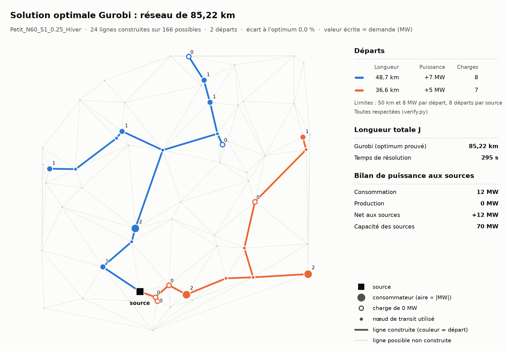

# Experiment 2: Gurobi vs HiGHS on Petit_N60_S1_0.25_Hiver

> Run on 8 November 2026. One instance only, so these results show a trend and do not prove a general ranking.

## What was tested

**Instance:** 60 nodes, 166 candidate lines, one source (70 MW), 15 loads totalling 12 MW.

**Limits:** at most 8 feeders, 50 km and 8 MW per feeder, and P×L at most 200 MW·km at any node.

**PLNE setup:** the same model was given to both solvers (7,240 variables), with a 600 s limit, on the same machine and with default solver settings. Gurobi used 16 threads. Neither solver had a warm start, because the Voronoi heuristic found no feasible solution.

## Result: PLNE with HiGHS vs Gurobi

| | HiGHS (via PuLP) | Gurobi |
|---|---|---|
| Status | Time limit reached | **Optimal** |
| Solution value J | 91.71 km | **85.22 km** |
| Lower bound | 65.85 km | 85.22 km |
| Gap | 28.2% | **0%** |
| Run time | 600 s (limit) | **295 s** |
| Length, longest feeder (≤ 50 km) | 45.9 km ✓ | 48.7 km ✓ |
| Power, highest feeder (≤ 8 MW) | 7 MW ✓ | 7 MW ✓ |
| Source power (≤ 70 MW) | 12 MW ✓ | 12 MW ✓ |
| Feeders used (≤ 8) | 2 ✓ | 2 ✓ |
| Max P×L at a node (≤ 200) | 144.4 ✓ | 121.7 ✓ |

Both solutions respect every constraint. Gurobi's network is 7.6% shorter than HiGHS's and is proven optimal.



## Comparison with the other methods

"Measured" values come from this experiment. "Separate run" values come from the result files of another run on this instance. "Figure" values are read from [the all-methods figure](../output/all_methods/Petit_N60_S1_0.25_Hiver_all_methods.png). Neither of the last two was re-run here.

| Method | J (km) | Time | Constraints | Source |
|---|---|---|---|---|
| **PLNE Gurobi** | **85.22** | 295 s, proven optimal | All respected | Measured |
| PLNE Gurobi, tightened model (4 threads) | 85.22 | 267 s, proven optimal | All respected | Separate run |
| PLNE HiGHS | 91.71 | 600 s, gap 28% | All respected | Measured |
| PLNE HiGHS extended, same model | 89.84 | 2,391 s (600 s + 1,791 s), gap 25% | All respected | Separate run |
| PLNE HiGHS extended, tightened model | 85.22 | 2,390 s (600 s + 1,790 s), gap 7% | All respected | Separate run |
| Exact subset dynamic program | 85.2 | 4.8 s, proven optimal | All respected | Figure |
| PLNE HiGHS, warm-started from TDA | 91.0 | 600 s, gap 27% | All respected | Figure |
| Voronoi + Steiner (4 distances) | 84.61 | under 0.6 s | **Violated:** L 78.4, P 10, P×L 285 | Measured |
| TDA variants of Voronoi (ToMATo init, shrink + grow, spectral) | 84.6 | under 0.8 s | **Violated:** L 78.4, P 10, P×L 285 | Figure |
| Local search after the heuristic (6 variants) | 79.9 to 84.6 | about 1.2 s | **Violated:** L, P, P×L | Figure |
| Designed feeders, savings | 88.9 | 1.6 s | **Violated:** L 59.3 | Figure |
| Designed feeders, Kruskal | 98.5 | 0.03 s | All respected | Figure |
| Designed feeders, merge tree | 91.7 | 0.03 s | All respected | Figure |
| Merge tree + local search | 91.5 | 0.07 s | All respected | Figure |

**Extended HiGHS runs:** both continue from the first 600 s run, whose solution becomes 89.84 km once useless transit branches are removed. Their total time is the first 600 s plus the second run. On the same model, the second run finds nothing better than this start. On the tightened model (10,248 variables, 6 feeders), it reaches 85.22 km with a lower bound of 79.41 km, so the optimum is found but not proven.

## Conclusions

- **Solution value:** the optimum is 85.22 km. Gurobi and the exact dynamic program reach it independently.
- **Run time:** Gurobi proves the optimum in 295 s, or 267 s on the tightened model. HiGHS has not found it after 600 s. Extended to about 40 minutes in total, HiGHS stays at 89.84 km on the same model, and finds 85.22 km on the tightened model with a 7% gap still open.
- **Constraints:** every result below 85.22 km violates the limits, so those shorter networks are not valid solutions.
- **Heuristics:** the fastest valid heuristic is merge tree + local search, at 91.5 km in 0.07 s, which is 7.4% above the optimum.
- **Exact dynamic program:** it is much faster than the PLNE here (4.8 s), but it enumerates sets of loads, so its cost should grow quickly on larger instances.

## Limits of this test

- This is a single small instance, and the solvers did not necessarily use the same number of threads.
- The P×L limit is not enforced by either PLNE or by `verify.py`. Here it was computed afterwards as the sum of |P| × length along the path from the source. Both PLNE solutions happen to respect it.

## Reproduce

```powershell
py plne_gurobi.py verified --prefix Petit_N60_S1_0.25_Hiver
py run_plne_verified.py --single data/verified_instances/Petit_N60_S1_0.25_Hiver.json --time-limit 600
```

The HiGHS command also needs `py -m pip install highspy`. Results are in `output/plne_gurobi/` and `output/plne_verified/`.
