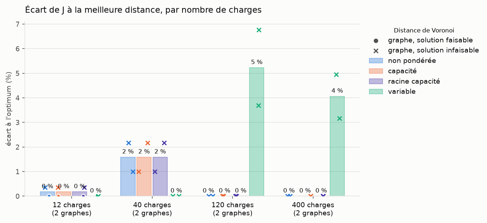
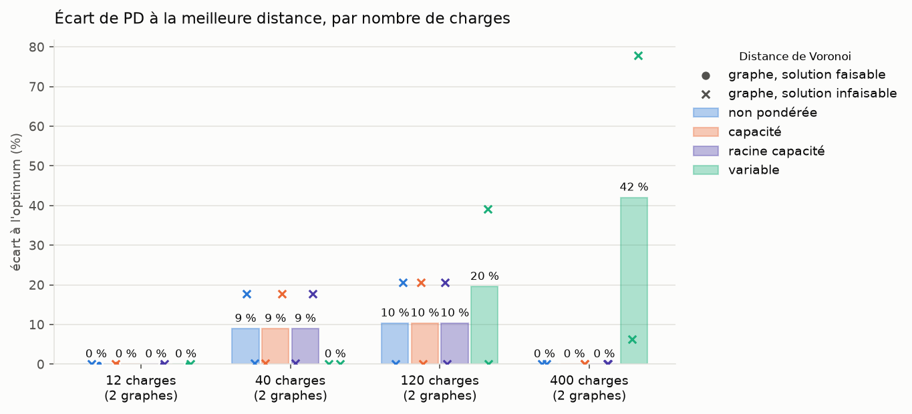
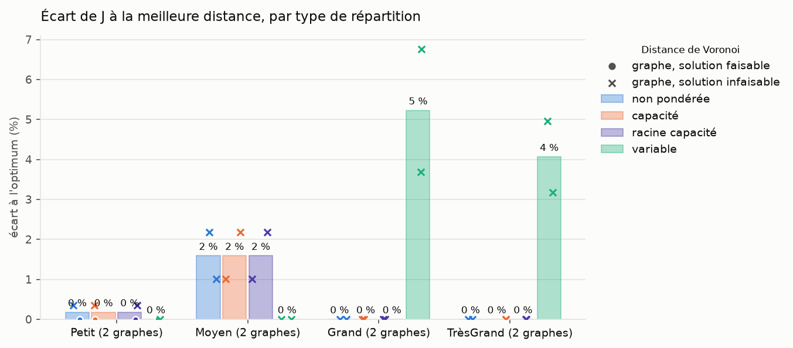
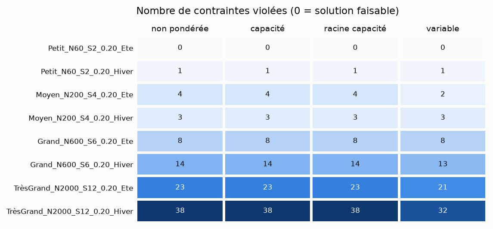

# Récapitulatif du run 20261102_193405_test_verified

Objectif minimisé : J = L_tot, longueur totale des arbres (km), comme dans data/exemple_ete_4_PS/model.lp. Les contraintes (L_max et P_max par départ, capacité des sources, nombre de départs) ne sont pas dans J : elles sont seulement vérifiées. Toutes les solutions sont comparées, même celles qui violent une contrainte (infaisables : en rouge dans les tableaux, croix sur les graphiques).

PD = Σ sur les arêtes des arbres de |puissance transitée| × longueur (MW·km), non inclus dans J.

Lecture : OK contrainte satisfaite partout, KO (violées/testées) sinon ; J en vert si la solution est faisable, en rouge sinon, en gras pour la plus courte solution du graphe (faisable ou non) ; PD : <b>valeur</b> = plus petit PD des 4 distances ; distances : <b>non pondérée</b>, <b>capacité</b>, <b>racine capacité</b>, <b>variable</b>.

## Détail par graphe et par distance

| Graphe | Type | Charges (dont <0) | Sources | Distance | J = L_tot (km) | PD (MW·km) | L_max départ | P_max départ | P_max source | Nb départs | Faisable |
|---|---|---|---|---|---|---|---|---|---|---|---|
| **Petit_N60_S2_0.20_Ete** | Petit | 12 (6) | 2 | <b>non pondérée</b> | <b>104.1</b> | <b>173.5</b> | OK | OK | OK | OK | <b>oui</b> |
|  |  |  |  | <b>capacité</b> | 104.1 | 173.5 | OK | OK | OK | OK | <b>oui</b> |
|  |  |  |  | <b>racine capacité</b> | 104.1 | 173.5 | OK | OK | OK | OK | <b>oui</b> |
|  |  |  |  | <b>variable</b> | 104.1 | 173.5 | OK | OK | OK | OK | <b>oui</b> |
| **Petit_N60_S2_0.20_Hiver** | Petit | 12 (0) | 2 | <b>non pondérée</b> | 103.6 | <b>136.8</b> | KO (1/2) | OK | OK | OK | <b>non</b> |
|  |  |  |  | <b>capacité</b> | 103.6 | 136.8 | KO (1/2) | OK | OK | OK | <b>non</b> |
|  |  |  |  | <b>racine capacité</b> | 103.6 | 136.8 | KO (1/2) | OK | OK | OK | <b>non</b> |
|  |  |  |  | <b>variable</b> | <b>103.2</b> | 136.8 | KO (1/2) | OK | OK | OK | <b>non</b> |
| **Moyen_N200_S4_0.20_Ete** | Moyen | 40 (20) | 4 | <b>non pondérée</b> | 322.2 | 828.2 | KO (3/10) | KO (1/10) | OK | OK | <b>non</b> |
|  |  |  |  | <b>capacité</b> | 322.2 | 828.2 | KO (3/10) | KO (1/10) | OK | OK | <b>non</b> |
|  |  |  |  | <b>racine capacité</b> | 322.2 | 828.2 | KO (3/10) | KO (1/10) | OK | OK | <b>non</b> |
|  |  |  |  | <b>variable</b> | <b>315.3</b> | <b>703.4</b> | KO (2/10) | OK | OK | OK | <b>non</b> |
| **Moyen_N200_S4_0.20_Hiver** | Moyen | 40 (0) | 4 | <b>non pondérée</b> | 325.0 | 1119.0 | KO (1/10) | KO (2/10) | OK | OK | <b>non</b> |
|  |  |  |  | <b>capacité</b> | 325.0 | 1119.0 | KO (1/10) | KO (2/10) | OK | OK | <b>non</b> |
|  |  |  |  | <b>racine capacité</b> | 325.0 | 1119.0 | KO (1/10) | KO (2/10) | OK | OK | <b>non</b> |
|  |  |  |  | <b>variable</b> | <b>321.8</b> | <b>1117.0</b> | KO (2/10) | KO (1/10) | OK | OK | <b>non</b> |
| **Grand_N600_S6_0.20_Ete** | Grand | 120 (60) | 6 | <b>non pondérée</b> | <b>620.3</b> | 2010.9 | KO (5/11) | KO (3/11) | OK | OK | <b>non</b> |
|  |  |  |  | <b>capacité</b> | 620.3 | 2010.9 | KO (5/11) | KO (3/11) | OK | OK | <b>non</b> |
|  |  |  |  | <b>racine capacité</b> | 620.3 | 2010.9 | KO (5/11) | KO (3/11) | OK | OK | <b>non</b> |
|  |  |  |  | <b>variable</b> | 662.2 | <b>1666.6</b> | KO (6/12) | KO (2/12) | OK | OK | <b>non</b> |
| **Grand_N600_S6_0.20_Hiver** | Grand | 120 (0) | 6 | <b>non pondérée</b> | <b>641.3</b> | <b>3419.5</b> | KO (7/15) | KO (7/15) | OK | OK | <b>non</b> |
|  |  |  |  | <b>capacité</b> | 641.3 | 3419.5 | KO (7/15) | KO (7/15) | OK | OK | <b>non</b> |
|  |  |  |  | <b>racine capacité</b> | 641.3 | 3419.5 | KO (7/15) | KO (7/15) | OK | OK | <b>non</b> |
|  |  |  |  | <b>variable</b> | 665.0 | 4756.7 | KO (6/13) | KO (7/13) | OK | OK | <b>non</b> |
| **TrèsGrand_N2000_S12_0.20_Ete** | TrèsGrand | 400 (200) | 12 | <b>non pondérée</b> | <b>1610.3</b> | <b>6480.7</b> | KO (13/25) | KO (10/25) | OK | OK | <b>non</b> |
|  |  |  |  | <b>capacité</b> | 1610.3 | 6480.7 | KO (13/25) | KO (10/25) | OK | OK | <b>non</b> |
|  |  |  |  | <b>racine capacité</b> | 1610.3 | 6480.7 | KO (13/25) | KO (10/25) | OK | OK | <b>non</b> |
|  |  |  |  | <b>variable</b> | 1661.3 | 11522.3 | KO (12/26) | KO (9/26) | OK | OK | <b>non</b> |
| **TrèsGrand_N2000_S12_0.20_Hiver** | TrèsGrand | 400 (0) | 12 | <b>non pondérée</b> | <b>1681.5</b> | <b>14078.3</b> | KO (16/25) | KO (20/25) | KO (2/12) | OK | <b>non</b> |
|  |  |  |  | <b>capacité</b> | 1681.5 | 14078.3 | KO (16/25) | KO (20/25) | KO (2/12) | OK | <b>non</b> |
|  |  |  |  | <b>racine capacité</b> | 1681.5 | 14078.3 | KO (16/25) | KO (20/25) | KO (2/12) | OK | <b>non</b> |
|  |  |  |  | <b>variable</b> | 1764.9 | 14964.1 | KO (14/25) | KO (18/25) | OK | OK | <b>non</b> |

## Fonction objectif J = L_tot (km) et produit PD (MW·km) par distance

J : vert si toutes les contraintes sont satisfaites, rouge sinon. En gras : plus petite valeur des 4 distances, solutions faisables ou non.

| Graphe | J <b>non pondérée</b> | J <b>capacité</b> | J <b>racine capacité</b> | J <b>variable</b> | PD <b>non pondérée</b> | PD <b>capacité</b> | PD <b>racine capacité</b> | PD <b>variable</b> | Meilleur J | Meilleur PD |
|---|---|---|---|---|---|---|---|---|---|---|
| Petit_N60_S2_0.20_Ete | <b>104.1</b> | 104.1 | 104.1 | 104.1 | **173.5** | 173.5 | 173.5 | 173.5 | <b>non pondérée</b> | <b>non pondérée</b> |
| Petit_N60_S2_0.20_Hiver | 103.6 | 103.6 | 103.6 | <b>103.2</b> | **136.8** | 136.8 | 136.8 | 136.8 | <b>variable</b> | <b>non pondérée</b> |
| Moyen_N200_S4_0.20_Ete | 322.2 | 322.2 | 322.2 | <b>315.3</b> | 828.2 | 828.2 | 828.2 | **703.4** | <b>variable</b> | <b>variable</b> |
| Moyen_N200_S4_0.20_Hiver | 325.0 | 325.0 | 325.0 | <b>321.8</b> | 1119.0 | 1119.0 | 1119.0 | **1117.0** | <b>variable</b> | <b>variable</b> |
| Grand_N600_S6_0.20_Ete | <b>620.3</b> | 620.3 | 620.3 | 662.2 | 2010.9 | 2010.9 | 2010.9 | **1666.6** | <b>non pondérée</b> | <b>variable</b> |
| Grand_N600_S6_0.20_Hiver | <b>641.3</b> | 641.3 | 641.3 | 665.0 | **3419.5** | 3419.5 | 3419.5 | 4756.7 | <b>non pondérée</b> | <b>non pondérée</b> |
| TrèsGrand_N2000_S12_0.20_Ete | <b>1610.3</b> | 1610.3 | 1610.3 | 1661.3 | **6480.7** | 6480.7 | 6480.7 | 11522.3 | <b>non pondérée</b> | <b>non pondérée</b> |
| TrèsGrand_N2000_S12_0.20_Hiver | <b>1681.5</b> | 1681.5 | 1681.5 | 1764.9 | **14078.3** | 14078.3 | 14078.3 | 14964.1 | <b>non pondérée</b> | <b>non pondérée</b> |

## Synthèse

Écart à l'optimum : 100 × (X − X_min) / X_min, X_min = plus petite valeur des 4 distances sur le graphe ; moyenne sur les graphes (comparable entre graphes de tailles différentes, contrairement aux moyennes de J et PD).

| Distance | Meilleur J (nb graphes) | Meilleur PD (nb graphes) | Runs faisables | Écart moyen J (%) | Écart moyen PD (%) | J moyen (km) | PD moyen (MW·km) |
|---|---|---|---|---|---|---|---|
| <b>non pondérée</b> | 5 | 5 | 1/8 | 0.4 | 4.8 | 676.0 | 3530.9 |
| <b>capacité</b> | 0 | 0 | 1/8 | 0.4 | 4.8 | 676.0 | 3530.9 |
| <b>racine capacité</b> | 0 | 0 | 1/8 | 0.4 | 4.8 | 676.0 | 3530.9 |
| <b>variable</b> | 3 | 3 | 1/8 | 2.3 | 15.4 | 699.7 | 4380.0 |

## Synthèse par nombre de charges

Par groupe de graphes de même nombre de charges : runs faisables, nombre de graphes où la distance donne le plus petit J, écart moyen de J à l'optimum.

| Charges | Graphes | Faisables <b>non pondérée</b> | Faisables <b>capacité</b> | Faisables <b>racine capacité</b> | Faisables <b>variable</b> | Meilleur J <b>non pondérée</b> | Meilleur J <b>capacité</b> | Meilleur J <b>racine capacité</b> | Meilleur J <b>variable</b> | Écart J (%) <b>non pondérée</b> | Écart J (%) <b>capacité</b> | Écart J (%) <b>racine capacité</b> | Écart J (%) <b>variable</b> |
|---|---|---|---|---|---|---|---|---|---|---|---|---|---|
| 12 | 2 | 1/2 | 1/2 | 1/2 | 1/2 | 1 | 0 | 0 | 1 | 0.2 | 0.2 | 0.2 | 0.0 |
| 40 | 2 | 0/2 | 0/2 | 0/2 | 0/2 | 0 | 0 | 0 | 2 | 1.6 | 1.6 | 1.6 | 0.0 |
| 120 | 2 | 0/2 | 0/2 | 0/2 | 0/2 | 2 | 0 | 0 | 0 | 0.0 | 0.0 | 0.0 | 5.2 |
| 400 | 2 | 0/2 | 0/2 | 0/2 | 0/2 | 2 | 0 | 0 | 0 | 0.0 | 0.0 | 0.0 | 4.1 |

## Graphiques

### Écart relatif à l'optimum de J, par nombre de charges

J = L_tot. Pour chaque graphe, l'optimum est la plus petite valeur des 4 distances (0 %), faisable ou non. Barres : écart moyen ; un marqueur par graphe : rond si la solution respecte les contraintes, croix sinon.

### Écart relatif à l'optimum de PD, par nombre de charges

Même lecture, pour le produit PD (puissance × distance).

### Écart relatif à l'optimum de J, par type de répartition

Quelle distance convient à quelle répartition des charges.

### Contraintes violées

Nombre total de contraintes violées (L_max, P_max départ, P_max source, nb départs, erreurs de structure) pour chaque graphe et chaque méthode.

