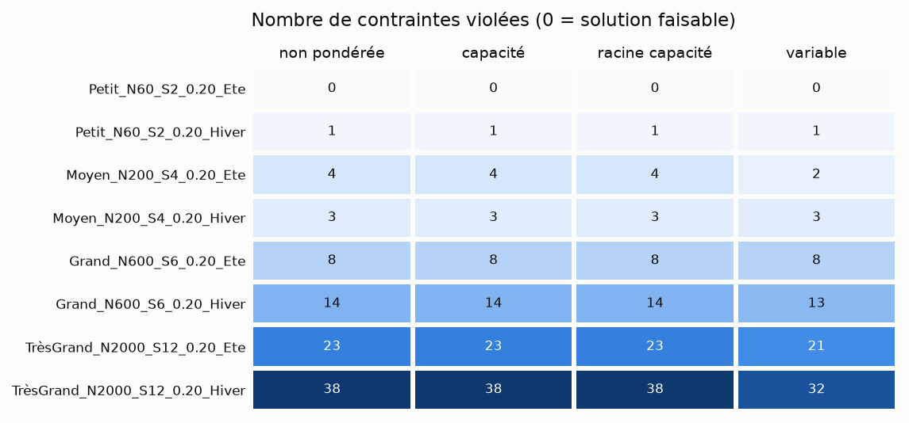
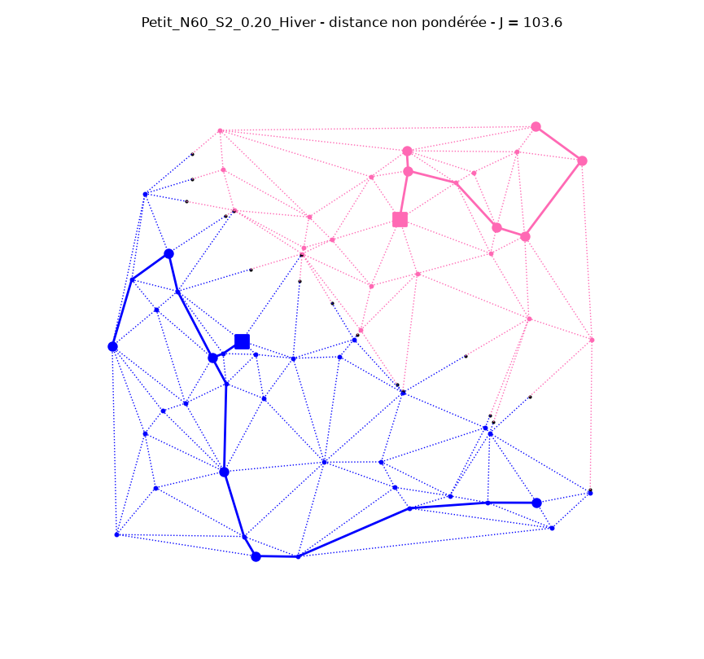
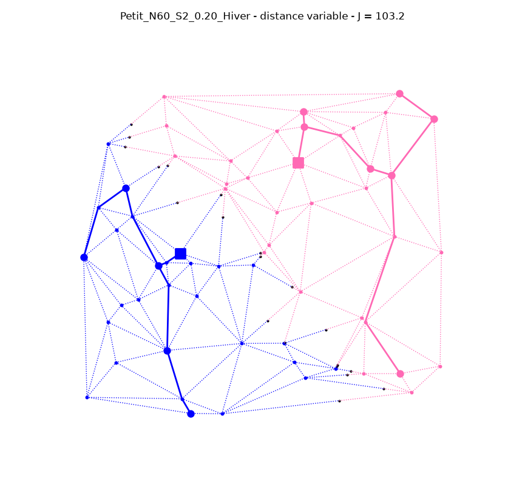
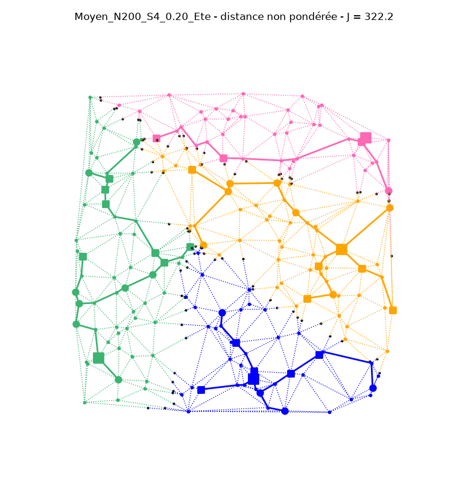
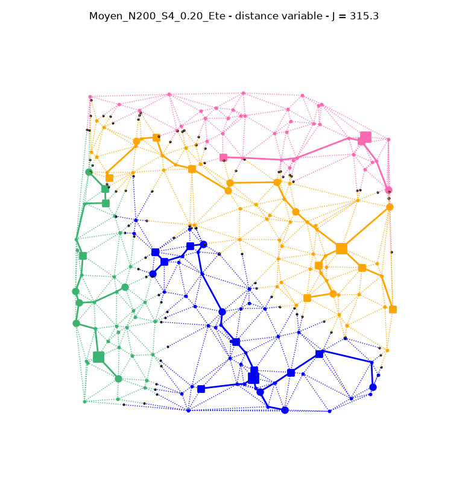
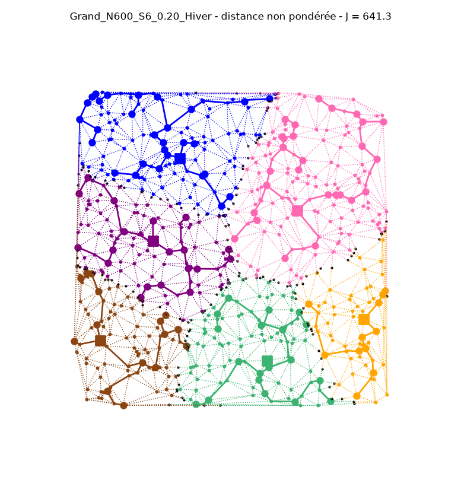
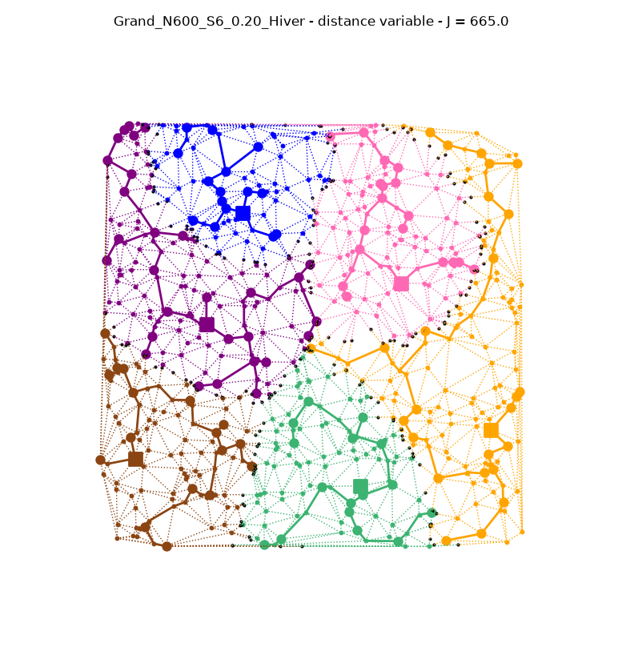
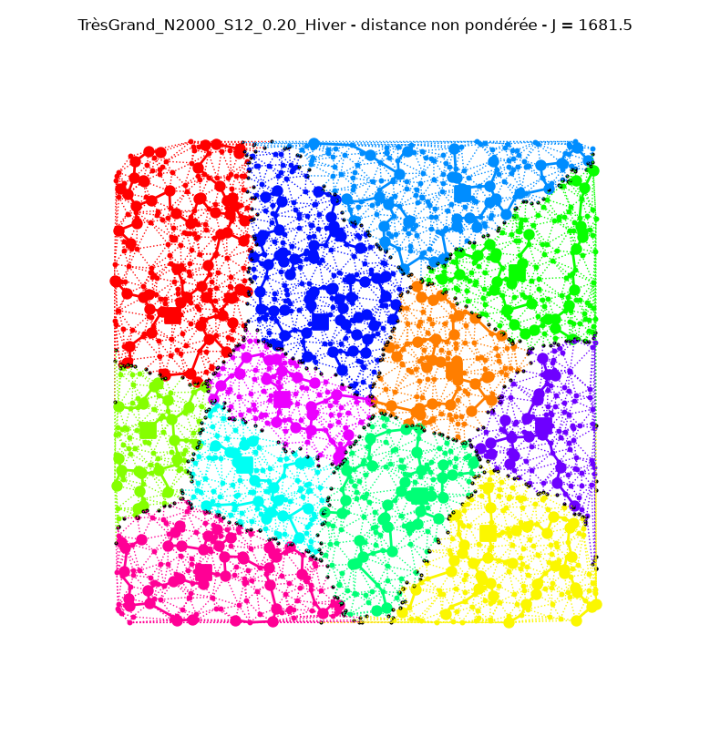
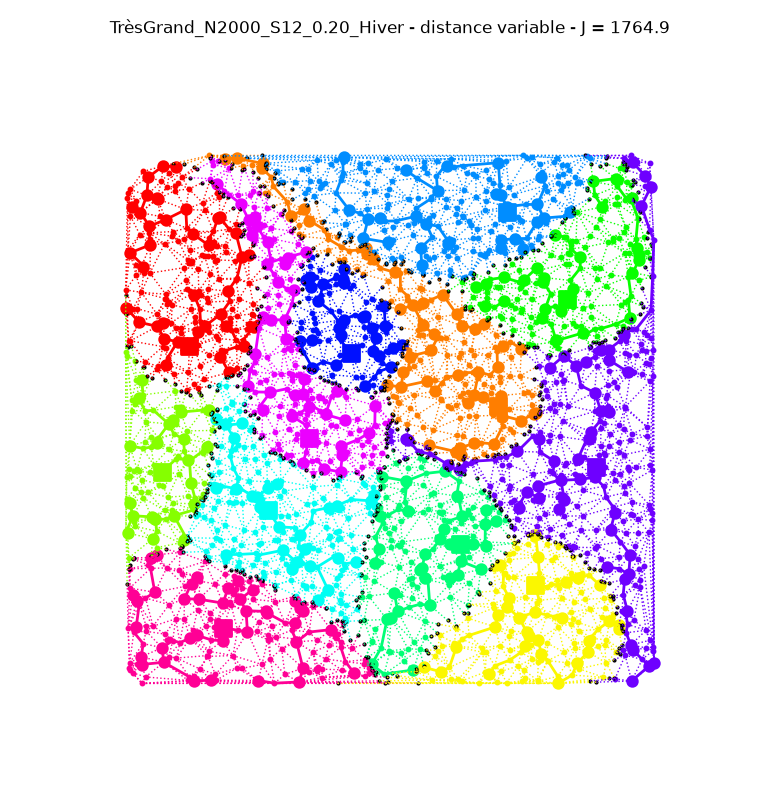

# Test de validation — heuristique Voronoi + Steiner sur `verified_instances/`

> Run `20261102_193405_test_verified` ([run_verified.py](../run_verified.py)). Rapports bruts : [recap](recap_20261102_193405_test_verified.md), [détails par départ](details_20261102_193405_test_verified.txt), [indicateurs](verified_20261102_193405_test_verified.csv).

8 instances, une par taille, densité 0,20, été et hiver.

## Lecture des données

| Paramètre de l'instance | Utilisé comme | Contrôlé par `verify.py` |
|---|---|---|
| `demande` d'une Source = 70 MW | capacité de la source | oui |
| `n_departs_max` = 8 | nombre de départs max par source | oui |
| `puissance_max_ligne` = 8 MW | `p_max_depart` : \|P_départ\| ≤ 8 MW (P_max du sujet, §2.4) | oui |
| `longueur_max_depart` = 50 km | `l_max_depart` : longueur totale d'un départ ≤ 50 km | oui |
| `PL_max_noeud` = 200 | budget puissance × distance, comparé au PD de chaque départ | **non**, indicateur seulement |

Toutes les sources ont la même capacité (70 MW). Les trois distances fixes (non pondérée, capacité, racine capacité) donnent donc les mêmes cellules et les mêmes arbres. Seule la distance variable s'en écarte.

## Résultats

« Fixe » = les 3 distances fixes (résultats identiques). Contraintes violées : nombre de départs ou de sources en défaut.

| Instance | Charge nette (MW) | Distance | J (km) | Faisable | L > 50 km | \|P\| > 8 MW | Départs utilisés | Flux max sur une ligne (MW) | Départs PD > 200 | Temps (s) |
|---|---|---|---|---|---|---|---|---|---|---|
| Petit_N60_S2_0.20_Ete | −6 | fixe | 104,1 | **oui** | 0 | 0 | 6 / 16 | 3 | 0 | 0,02 |
| | | variable | 104,1 | **oui** | 0 | 0 | 6 / 16 | 3 | 0 | 0,03 |
| Petit_N60_S2_0.20_Hiver | 9 | fixe | 103,6 | non | 1 | 0 | 2 / 16 | 5 | 0 | 0,02 |
| | | variable | 103,2 | non | 1 | 0 | 2 / 16 | 5 | 0 | 1,2 |
| Moyen_N200_S4_0.20_Ete | −9 | fixe | 322,2 | non | 3 | 1 | 10 / 32 | 9 | 2 | 0,04 |
| | | variable | 315,3 | non | 2 | 0 | 10 / 32 | 7 | 0 | 3,8 |
| Moyen_N200_S4_0.20_Hiver | 48 | fixe | 325,0 | non | 1 | 2 | 10 / 32 | 9 | 1 | 0,05 |
| | | variable | 321,8 | non | 2 | 1 | 10 / 32 | 9 | 2 | 3,8 |
| Grand_N600_S6_0.20_Ete | −48 | fixe | 620,3 | non | 5 | 3 | 11 / 48 | 23 | 3 | 0,1 |
| | | variable | 662,2 | non | 6 | 2 | 12 / 48 | 16 | 3 | 11,4 |
| Grand_N600_S6_0.20_Hiver | 157 | fixe | 641,3 | non | 7 | 7 | 15 / 48 | 32 | 6 | 0,1 |
| | | variable | 665,0 | non | 6 | 7 | 13 / 48 | 31 | 7 | 11,4 |
| TrèsGrand_N2000_S12_0.20_Ete | −184 | fixe | 1610,3 | non | 13 | 10 | 25 / 96 | 49 | 9 | 0,3 |
| | | variable | 1661,3 | non | 12 | 9 | 26 / 96 | 55 | 10 | 37,8 |
| TrèsGrand_N2000_S12_0.20_Hiver | 503 | fixe | 1681,5 | non | 16 | 20 | 25 / 96 | 68 | 17 | 0,3 |
| | | variable | 1764,9 | non | 14 | 18 | 25 / 96 | 47 | 15 | 38,4 |

La capacité des sources et le nombre de départs ne sont jamais violés (sauf 2 sources sur la plus grande instance d'hiver, en distance fixe). Aucune instance n'est prouvée infaisable par `necessary_conditions`.



## Diagnostic : les départs, pas les cellules

Les sources ont de la marge, mais l'arbre de Steiner n'utilise que 1 à 3 départs sur 8 par source. Chaque départ est donc trop long et trop chargé. Exemple, `Grand_N600_S6_0.20_Hiver`, distance fixe :

```
Source 3: P = 22.00 / 70.00 MW OK | départs 1 / 8 OK | 37 noeuds dans l'arbre
  départ 0 (tête 70, 36 noeuds): L = 110.0 / 50 km KO | P = 22.00 / 8 MW KO
```

22 MW tiendraient dans 3 départs de 8 MW, et 110 km dans 3 départs de 50 km. Mais Steiner minimise la longueur sans tenir compte des départs : il relie la cellule à la source par une seule arête. La distance variable ne peut que rétrécir les cellules des sources en surcharge. Les autres sources débordent alors à leur tour, d'où 60 itérations sans succès et parfois un J plus grand (Grand, TrèsGrand).

## Figures (distance fixe à gauche, variable à droite)

Carrés : sources (grands) et producteurs (petits) ; ronds : consommateurs ; traits pleins : arbres de Steiner.

**Petit_N60_S2_0.20_Hiver.** Un seul départ par source ; le départ rose fait 59,7 km.

 

**Moyen_N200_S4_0.20_Ete**

 

**Grand_N600_S6_0.20_Hiver**

 

**TrèsGrand_N2000_S12_0.20_Hiver**

 
