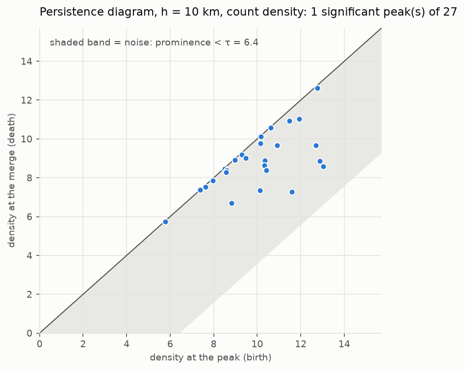
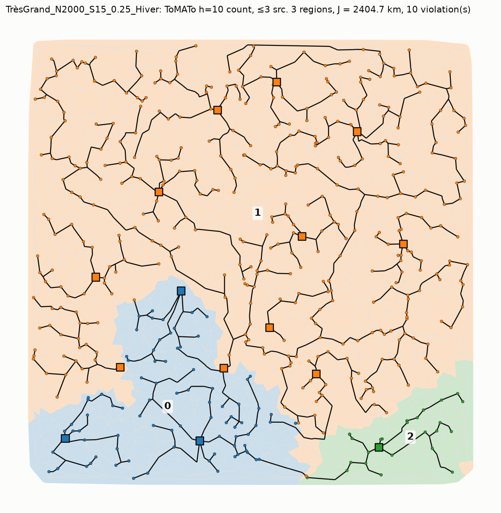

# ToMATo decomposition of TrèsGrand_N2000_S15_0.25_Hiver

08/11/2026 19:21 · n_iter = 60, local search 20 s per region (300 s for the whole instance), polish 60 s.

## Instance

2000 nodes, 5975 edges, 500 loads, 120 feeders. Necessary conditions of verify.py: charges à plus de l_max_depart de toutes les sources : [474].

## Is there a natural clustering?

Bottleneck bootstrap of AuToMATo on the persistence diagrams (α = 0.35, B = 200, loads resampled with replacement):

| h (km) | Density | Peaks | Largest finite prominence | τ bootstrap | Significant peaks |
|---|---|---|---|---|---|
| 3 | power | 145 | 4.34 | 9.51 | 1 |
| 3 | count | 142 | 2.88 | 5.34 | 1 |
| 5 | power | 68 | 5.61 | 9.86 | 1 |
| 5 | count | 67 | 3.64 | 5.72 | 1 |
| 7 | power | 42 | 6.25 | 10.16 | 1 |
| 7 | count | 41 | 4.00 | 5.79 | 1 |
| 10 | power | 29 | 6.68 | 9.24 | 1 |
| 10 | count | 27 | 4.45 | 6.44 | 1 |

## Results

Ranked by verify.py on the whole graph: errors, violations, excess, then J.

| Configuration | Regions | Max loads in a region | J (km) | Violations | L / P / source / n | CPU (s) | Time if regions run in parallel (s) |
|---|---|---|---|---|---|---|---|
| ToMATo h=10 count, ≤3 src | 3 | 392 | 2404.7 | 10 | 4 / 5 / 1 / 0 | 193 | 163 |
| ToMATo h=3 count, ≤3 src | 4 | 255 | 2511.2 | 13 | 5 / 7 / 1 / 0 | 282 | 147 |
| ToMATo h=3 power, ≤3 src | 1 | 500 | 2438.5 | 14 | 4 / 9 / 1 / 0 | 251 | 251 |
| whole instance | 1 | — | 2438.5 | 14 | 4 / 9 / 1 / 0 | 159 | 159 |
| ToMATo h=7 power, ≤2 src | 7 | 154 | 2401.5 | 15 | 6 / 8 / 1 / 0 | 211 | 74 |
| ToMATo h=5 power, ≤2 src | 6 | 195 | 2399.8 | 18 | 5 / 12 / 1 / 0 | 290 | 108 |
| Voronoi control, ≤3 src | 5 | 128 | 2255.2 | 18 | 6 / 11 / 1 / 0 | 164 | 54 |
| ToMATo h=5 power, ≤3 src | 5 | 175 | 2367.8 | 18 | 7 / 11 / 0 / 0 | 296 | 125 |
| ToMATo h=7 power, ≤1 src | 10 | 120 | 2293.2 | 18 | 6 / 11 / 1 / 0 | 193 | 90 |
| ToMATo h=10 count, ≤1 src | 7 | 189 | 2346.6 | 18 | 8 / 9 / 1 / 0 | 173 | 86 |
| ToMATo h=10 count, ≤2 src | 4 | 229 | 2313.0 | 18 | 7 / 10 / 1 / 0 | 199 | 99 |
| Voronoi control, ≤2 src | 7 | 128 | 2314.2 | 19 | 6 / 13 / 0 / 0 | 153 | 53 |
| ToMATo h=7 count, ≤3 src | 4 | 185 | 2395.0 | 19 | 8 / 11 / 0 / 0 | 181 | 67 |
| ToMATo h=7 count, ≤2 src | 8 | 116 | 2344.1 | 19 | 8 / 11 / 0 / 0 | 190 | 57 |
| ToMATo h=7 count, ≤1 src | 10 | 155 | 2342.2 | 19 | 8 / 11 / 0 / 0 | 138 | 68 |
| Voronoi control, ≤1 src | 13 | 103 | 2355.0 | 19 | 6 / 13 / 0 / 0 | 106 | 47 |
| ToMATo h=7 power, ≤3 src | 5 | 164 | 2526.5 | 19 | 7 / 11 / 1 / 0 | 200 | 73 |
| ToMATo h=3 power, ≤2 src | 4 | 298 | 2433.5 | 20 | 6 / 14 / 0 / 0 | 272 | 167 |
| ToMATo h=5 power, ≤1 src | 11 | 153 | 2409.6 | 20 | 8 / 12 / 0 / 0 | 218 | 99 |
| ToMATo h=10 power, ≤3 src | 6 | 125 | 2318.8 | 21 | 8 / 13 / 0 / 0 | 178 | 53 |
| ToMATo h=3 power, ≤1 src | 2 | 499 | 2350.4 | 22 | 7 / 15 / 0 / 0 | 276 | 276 |
| ToMATo h=3 count, ≤1 src | 10 | 209 | 2444.5 | 22 | 7 / 15 / 0 / 0 | 159 | 119 |
| ToMATo h=10 power, ≤1 src | 10 | 104 | 2478.9 | 22 | 8 / 14 / 0 / 0 | 123 | 49 |
| ToMATo h=3 count, ≤2 src | 7 | 244 | 2416.2 | 23 | 8 / 15 / 0 / 0 | 222 | 136 |
| ToMATo h=10 power, ≤2 src | 8 | 104 | 2278.7 | 23 | 8 / 15 / 0 / 0 | 176 | 54 |
| ToMATo h=5 count, ≤1 src | 9 | 121 | 2275.6 | 23 | 10 / 13 / 0 / 0 | 261 | 88 |
| ToMATo h=5 count, ≤3 src | 3 | 381 | 2216.5 | 26 | 12 / 14 / 0 / 0 | 301 | 244 |
| ToMATo h=5 count, ≤2 src | 6 | 246 | 2382.3 | 28 | 11 / 17 / 0 / 0 | 278 | 141 |

## Best decomposition

**ToMATo h=10 count, ≤3 src**, against the whole-instance run: J = 2404.7 km with 10 violation(s), against J = 2438.5 km with 14 violation(s).

Full PLNE model (plne_reseau.build_model): 3,885,000 variables. Largest subproblem: 2,178,704; sum over the subproblems: 2,313,872.

| Region | Nodes | Edges | Sources | Loads | Net power (MW) | Usage | Variables of the PLNE | J (km) | Violations |
|---|---|---|---|---|---|---|---|---|---|
| 0 | 329 | 925 | 3 | 83 | 102 | 0.53 | 120,888 | 403.1 | 3 |
| 1 | 1551 | 4563 | 11 | 392 | 452 | 0.64 | 2,178,704 | 1836.8 | 8 |
| 2 | 120 | 328 | 1 | 25 | 26 | 0.41 | 14,280 | 118.9 | 0 |
