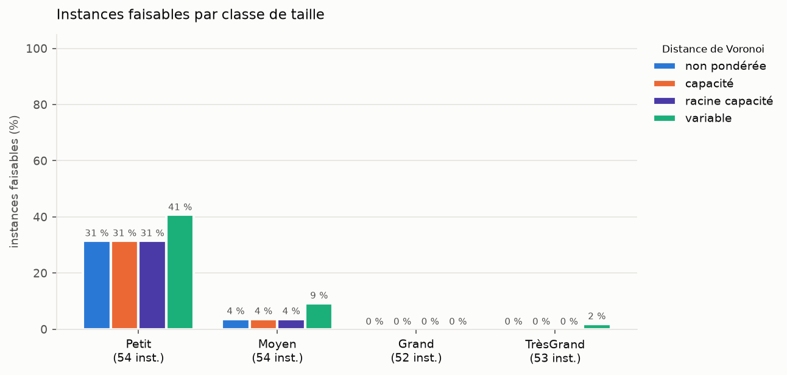
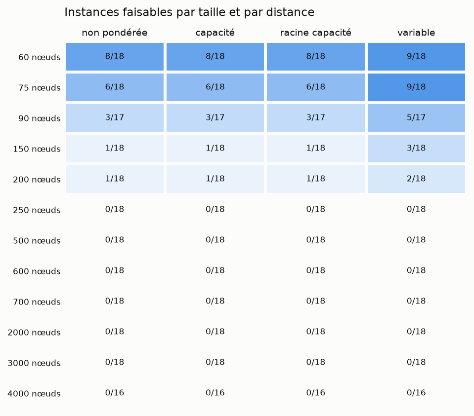
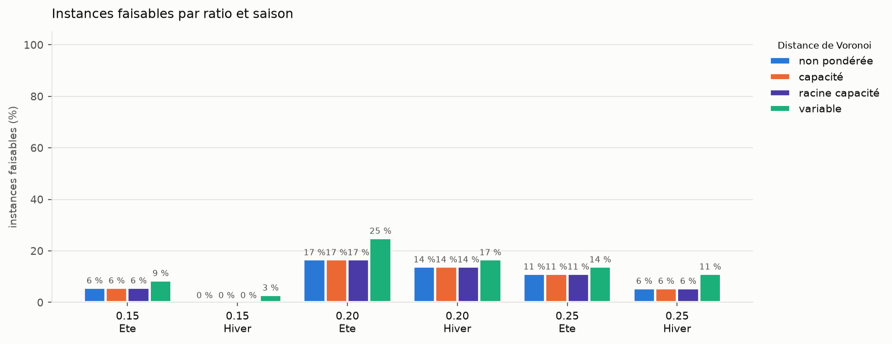
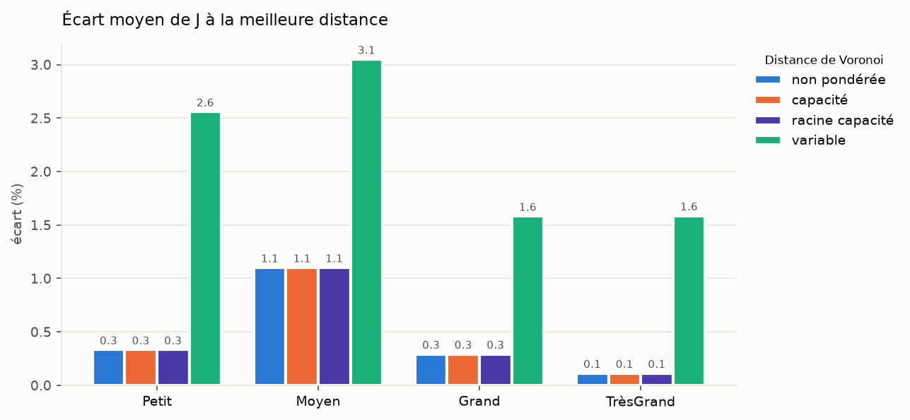
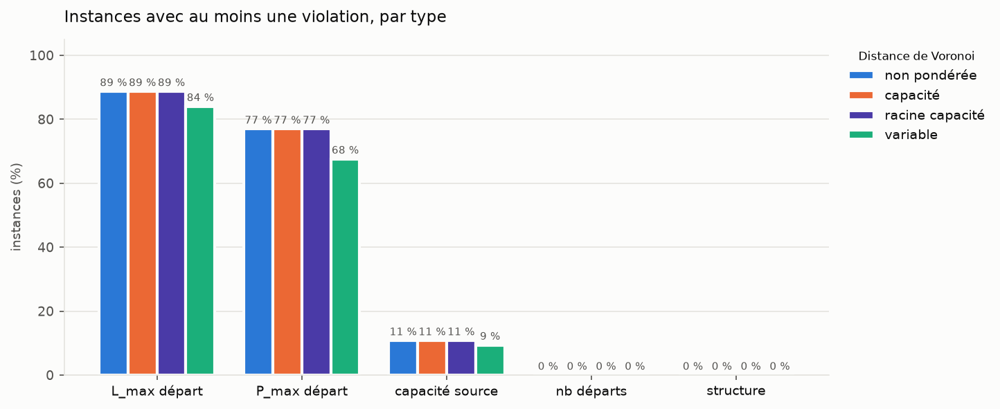
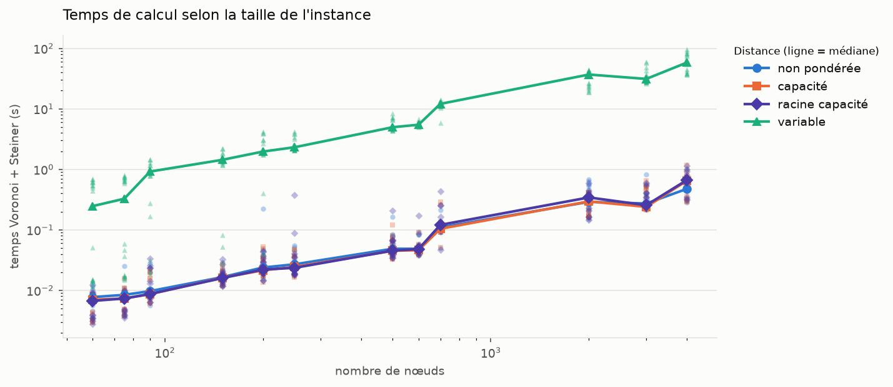

# Voronoi + Steiner sur les instances vérifiées

03/11/2026 17:08 · 213 instances · 4 distances : <b>non pondérée</b>, <b>capacité</b>, <b>racine capacité</b>, <b>variable</b>.

J = L_tot, longueur totale des arbres (km), à minimiser. Une solution est faisable si les arbres forment un réseau radial valide couvrant toutes les charges et respectent L_max et P_max par départ, la capacité des sources et le nombre de départs (verify.py). Temps = Voronoi + Steiner (+ ajustement des poids pour la distance variable).

## Synthèse

| Distance | Faisables | Meilleure solution faisable | Écart moyen de J (%) | Temps moyen (s) | Temps médian (s) | Temps max (s) |
|---|---|---|---|---|---|---|
| <b>non pondérée</b> | 19/213 (9 %) | 19 | 0.5 | 0.13 | 0.04 | 1.03 |
| <b>capacité</b> | 19/213 (9 %) | 0 | 0.5 | 0.13 | 0.04 | 1.16 |
| <b>racine capacité</b> | 19/213 (9 %) | 0 | 0.5 | 0.14 | 0.04 | 1.13 |
| <b>variable</b> | 28/213 (13 %) | 9 | 2.2 | 12.92 | 4.22 | 97.13 |

Au moins une distance faisable : **28/213** instances. Instances prouvées infaisables (conditions nécessaires de verify.py) : 25.

### Par classe de taille

| Classe | Instances | Nœuds | Faisables <b>non pondérée</b> | Faisables <b>capacité</b> | Faisables <b>racine capacité</b> | Faisables <b>variable</b> | Temps moyen variable (s) |
|---|---|---|---|---|---|---|---|
| Petit | 54 | 60, 75, 90, 250 | 17/54 | 17/54 | 17/54 | 22/54 | 0.56 |
| Moyen | 54 | 150, 200, 250, 700 | 2/54 | 2/54 | 2/54 | 5/54 | 2.44 |
| Grand | 52 | 500, 600, 700 | 0/52 | 0/52 | 0/52 | 0/52 | 7.44 |
| TrèsGrand | 53 | 90, 2000, 3000, 4000 | 0/53 | 0/53 | 0/53 | 1/53 | 41.58 |

## Graphiques

### Instances faisables par classe de taille

Part des instances où la solution respecte toutes les contraintes.

### Instances faisables par nombre de nœuds

Nombre d'instances faisables / nombre d'instances, pour chaque taille et chaque distance.

### Instances faisables par ratio et saison

Ratio et saison lus dans le nom de l'instance (…_<ratio>_<saison>).

### Écart de J à la meilleure distance

Pour chaque instance : 100 × (J − J_min) / J_min, J_min = plus petit J des 4 distances (faisable ou non) ; moyenne par classe.

### Contraintes violées

Part des instances où au moins une contrainte du type est violée (structure = arbre invalide).

### Temps de calcul

Un point par instance, ligne = médiane par taille. Échelles logarithmiques.

## Détail par instance

J (km) et temps (s) de chaque distance : vert = faisable, rouge = infaisable, gras = plus petit J des 4. Le nom renvoie à l'image de l'instance.

| Instance | Nœuds | Sources | Charges (prod) | <b>non pondérée</b> | <b>capacité</b> | <b>racine capacité</b> | <b>variable</b> | Meilleure faisable |
|---|---|---|---|---|---|---|---|---|
| [Petit_N60_S1_0.20_Ete (1)](figures/Petit_N60_S1_0.20_Ete%20(1).png) | 60 | 1 | 8 (4) | <b>68.7</b> (0.00 s) | <b>68.7</b> (0.00 s) | <b>68.7</b> (0.00 s) | <b>68.7</b> (0.55 s) | — |
| [Petit_N60_S1_0.20_Hiver (1)](figures/Petit_N60_S1_0.20_Hiver%20(1).png) | 60 | 1 | 9 (0) | <b>60.1</b> (0.00 s) | <b>60.1</b> (0.00 s) | <b>60.1</b> (0.00 s) | <b>60.1</b> (0.44 s) | — |
| [Petit_N60_S1_0.25_Ete (1)](figures/Petit_N60_S1_0.25_Ete%20(1).png) | 60 | 1 | 12 (6) | <b>70.4</b> (0.00 s) | <b>70.4</b> (0.00 s) | <b>70.4</b> (0.00 s) | <b>70.4</b> (0.01 s) | <b>non pondérée</b> |
| [Petit_N60_S1_0.25_Hiver (1)](figures/Petit_N60_S1_0.25_Hiver%20(1).png) | 60 | 1 | 12 (0) | <b>60.8</b> (0.00 s) | <b>60.8</b> (0.00 s) | <b>60.8</b> (0.00 s) | <b>60.8</b> (0.51 s) | — |
| [Petit_N60_S2_0.15_Ete (1)](figures/Petit_N60_S2_0.15_Ete%20(1).png) | 60 | 1 | 16 (8) | <b>88.1</b> (0.00 s) | <b>88.1</b> (0.00 s) | <b>88.1</b> (0.00 s) | <b>88.1</b> (0.60 s) | — |
| [Petit_N60_S2_0.15_Hiver (1)](figures/Petit_N60_S2_0.15_Hiver%20(1).png) | 60 | 1 | 15 (0) | <b>84.6</b> (0.01 s) | <b>84.6</b> (0.00 s) | <b>84.6</b> (0.00 s) | <b>84.6</b> (0.63 s) | — |
| [Petit_N60_S2_0.20_Ete (1)](figures/Petit_N60_S2_0.20_Ete%20(1).png) | 60 | 2 | 8 (4) | <b>93.9</b> (0.01 s) | <b>93.9</b> (0.01 s) | <b>93.9</b> (0.01 s) | <b>93.9</b> (0.01 s) | <b>non pondérée</b> |
| [Petit_N60_S2_0.20_Hiver (1)](figures/Petit_N60_S2_0.20_Hiver%20(1).png) | 60 | 2 | 9 (0) | <b>105.3</b> (0.01 s) | <b>105.3</b> (0.01 s) | <b>105.3</b> (0.01 s) | <b>105.3</b> (0.01 s) | <b>non pondérée</b> |
| [Petit_N60_S2_0.25_Ete (1)](figures/Petit_N60_S2_0.25_Ete%20(1).png) | 60 | 2 | 12 (6) | <b>104.1</b> (0.01 s) | <b>104.1</b> (0.01 s) | <b>104.1</b> (0.01 s) | <b>104.1</b> (0.01 s) | <b>non pondérée</b> |
| [Petit_N60_S2_0.25_Hiver (1)](figures/Petit_N60_S2_0.25_Hiver%20(1).png) | 60 | 2 | 12 (0) | 103.6 (0.01 s) | 103.6 (0.01 s) | 103.6 (0.01 s) | <b>103.2</b> (0.54 s) | — |
| [Petit_N60_S3_0.15_Ete (1)](figures/Petit_N60_S3_0.15_Ete%20(1).png) | 60 | 2 | 16 (8) | <b>111.9</b> (0.01 s) | <b>111.9</b> (0.01 s) | <b>111.9</b> (0.01 s) | 135.2 (0.69 s) | — |
| [Petit_N60_S3_0.15_Hiver (1)](figures/Petit_N60_S3_0.15_Hiver%20(1).png) | 60 | 2 | 15 (0) | <b>141.5</b> (0.01 s) | <b>141.5</b> (0.01 s) | <b>141.5</b> (0.01 s) | <b>141.5</b> (0.63 s) | — |
| [Petit_N60_S3_0.20_Ete (1)](figures/Petit_N60_S3_0.20_Ete%20(1).png) | 60 | 3 | 8 (4) | <b>76.0</b> (0.01 s) | <b>76.0</b> (0.01 s) | <b>76.0</b> (0.01 s) | <b>76.0</b> (0.01 s) | <b>non pondérée</b> |
| [Petit_N60_S3_0.20_Hiver (1)](figures/Petit_N60_S3_0.20_Hiver%20(1).png) | 60 | 3 | 9 (0) | <b>141.3</b> (0.01 s) | <b>141.3</b> (0.01 s) | <b>141.3</b> (0.01 s) | <b>141.3</b> (0.02 s) | <b>non pondérée</b> |
| [Petit_N60_S3_0.25_Ete (1)](figures/Petit_N60_S3_0.25_Ete%20(1).png) | 60 | 3 | 12 (6) | <b>142.2</b> (0.01 s) | <b>142.2</b> (0.01 s) | <b>142.2</b> (0.01 s) | <b>142.2</b> (0.02 s) | <b>non pondérée</b> |
| [Petit_N60_S3_0.25_Hiver (1)](figures/Petit_N60_S3_0.25_Hiver%20(1).png) | 60 | 3 | 12 (0) | <b>130.9</b> (0.01 s) | <b>130.9</b> (0.01 s) | <b>130.9</b> (0.01 s) | 134.4 (0.05 s) | <b>variable</b> |
| [Petit_N75_S1_0.15_Ete (1)](figures/Petit_N75_S1_0.15_Ete%20(1).png) | 60 | 3 | 16 (8) | <b>141.7</b> (0.01 s) | <b>141.7</b> (0.01 s) | <b>141.7</b> (0.01 s) | <b>141.7</b> (0.01 s) | <b>non pondérée</b> |
| [Petit_N75_S1_0.15_Hiver (1)](figures/Petit_N75_S1_0.15_Hiver%20(1).png) | 60 | 3 | 15 (0) | <b>170.0</b> (0.01 s) | <b>170.0</b> (0.01 s) | <b>170.0</b> (0.01 s) | 192.7 (0.70 s) | — |
| [Petit_N75_S1_0.20_Ete (1)](figures/Petit_N75_S1_0.20_Ete%20(1).png) | 75 | 1 | 12 (6) | <b>75.7</b> (0.00 s) | <b>75.7</b> (0.00 s) | <b>75.7</b> (0.00 s) | <b>75.7</b> (0.64 s) | — |
| [Petit_N75_S1_0.20_Hiver (1)](figures/Petit_N75_S1_0.20_Hiver%20(1).png) | 75 | 1 | 11 (0) | <b>63.5</b> (0.00 s) | <b>63.5</b> (0.00 s) | <b>63.5</b> (0.00 s) | <b>63.5</b> (0.59 s) | — |
| [Petit_N75_S1_0.25_Ete (1)](figures/Petit_N75_S1_0.25_Ete%20(1).png) | 75 | 1 | 16 (8) | <b>79.0</b> (0.00 s) | <b>79.0</b> (0.00 s) | <b>79.0</b> (0.00 s) | <b>79.0</b> (0.66 s) | — |
| [Petit_N75_S1_0.25_Hiver (1)](figures/Petit_N75_S1_0.25_Hiver%20(1).png) | 75 | 1 | 15 (0) | <b>75.5</b> (0.00 s) | <b>75.5</b> (0.00 s) | <b>75.5</b> (0.00 s) | <b>75.5</b> (0.63 s) | — |
| [Petit_N75_S2_0.15_Ete (1)](figures/Petit_N75_S2_0.15_Ete%20(1).png) | 75 | 1 | 18 (9) | <b>103.8</b> (0.00 s) | <b>103.8</b> (0.00 s) | <b>103.8</b> (0.00 s) | <b>103.8</b> (0.74 s) | — |
| [Petit_N75_S2_0.15_Hiver (1)](figures/Petit_N75_S2_0.15_Hiver%20(1).png) | 75 | 1 | 19 (0) | <b>80.8</b> (0.00 s) | <b>80.8</b> (0.00 s) | <b>80.8</b> (0.00 s) | <b>80.8</b> (0.73 s) | — |
| [Petit_N75_S2_0.20_Ete (1)](figures/Petit_N75_S2_0.20_Ete%20(1).png) | 75 | 2 | 12 (6) | <b>123.4</b> (0.01 s) | <b>123.4</b> (0.01 s) | <b>123.4</b> (0.01 s) | 139.1 (0.05 s) | <b>variable</b> |
| [Petit_N75_S2_0.20_Hiver (1)](figures/Petit_N75_S2_0.20_Hiver%20(1).png) | 75 | 2 | 11 (0) | <b>90.3</b> (0.01 s) | <b>90.3</b> (0.01 s) | <b>90.3</b> (0.01 s) | 124.7 (0.76 s) | — |
| [Petit_N75_S2_0.25_Ete (1)](figures/Petit_N75_S2_0.25_Ete%20(1).png) | 75 | 2 | 16 (8) | <b>109.3</b> (0.01 s) | <b>109.3</b> (0.01 s) | <b>109.3</b> (0.01 s) | <b>109.3</b> (0.01 s) | <b>non pondérée</b> |
| [Petit_N75_S2_0.25_Hiver (1)](figures/Petit_N75_S2_0.25_Hiver%20(1).png) | 75 | 2 | 15 (0) | <b>136.0</b> (0.01 s) | <b>136.0</b> (0.01 s) | <b>136.0</b> (0.01 s) | <b>136.0</b> (0.02 s) | <b>non pondérée</b> |
| [Petit_N75_S3_0.15_Ete (1)](figures/Petit_N75_S3_0.15_Ete%20(1).png) | 75 | 2 | 18 (9) | <b>114.1</b> (0.01 s) | <b>114.1</b> (0.01 s) | <b>114.1</b> (0.01 s) | 117.2 (0.69 s) | — |
| [Petit_N75_S3_0.15_Hiver (1)](figures/Petit_N75_S3_0.15_Hiver%20(1).png) | 75 | 2 | 19 (0) | <b>131.7</b> (0.01 s) | <b>131.7</b> (0.01 s) | <b>131.7</b> (0.01 s) | 148.2 (0.80 s) | — |
| [Petit_N75_S3_0.20_Ete (1)](figures/Petit_N75_S3_0.20_Ete%20(1).png) | 75 | 3 | 12 (6) | <b>126.4</b> (0.01 s) | <b>126.4</b> (0.01 s) | <b>126.4</b> (0.01 s) | <b>126.4</b> (0.02 s) | <b>non pondérée</b> |
| [Petit_N75_S3_0.20_Hiver (1)](figures/Petit_N75_S3_0.20_Hiver%20(1).png) | 75 | 3 | 11 (0) | <b>124.2</b> (0.01 s) | <b>124.2</b> (0.01 s) | <b>124.2</b> (0.01 s) | <b>124.2</b> (0.02 s) | <b>non pondérée</b> |
| [Petit_N75_S3_0.25_Ete (1)](figures/Petit_N75_S3_0.25_Ete%20(1).png) | 75 | 3 | 16 (8) | <b>184.4</b> (0.01 s) | <b>184.4</b> (0.01 s) | <b>184.4</b> (0.01 s) | 195.0 (0.06 s) | <b>variable</b> |
| [Petit_N75_S3_0.25_Hiver (1)](figures/Petit_N75_S3_0.25_Hiver%20(1).png) | 75 | 3 | 15 (0) | <b>161.4</b> (0.01 s) | <b>161.4</b> (0.01 s) | <b>161.4</b> (0.01 s) | <b>161.4</b> (0.02 s) | <b>non pondérée</b> |
| [Petit_N90_S1_0.15_Ete (1)](figures/Petit_N90_S1_0.15_Ete%20(1).png) | 75 | 3 | 18 (9) | <b>146.2</b> (0.03 s) | <b>146.2</b> (0.02 s) | <b>146.2</b> (0.01 s) | <b>146.2</b> (0.02 s) | <b>non pondérée</b> |
| [Petit_N90_S1_0.15_Hiver (1)](figures/Petit_N90_S1_0.15_Hiver%20(1).png) | 75 | 3 | 19 (0) | <b>191.4</b> (0.01 s) | <b>191.4</b> (0.01 s) | <b>191.4</b> (0.01 s) | 205.7 (0.04 s) | <b>variable</b> |
| [Petit_N90_S1_0.20_Ete (1)](figures/Petit_N90_S1_0.20_Ete%20(1).png) | 90 | 1 | 14 (7) | <b>78.1</b> (0.01 s) | <b>78.1</b> (0.01 s) | <b>78.1</b> (0.01 s) | <b>78.1</b> (0.02 s) | <b>non pondérée</b> |
| [Petit_N90_S1_0.20_Hiver (1)](figures/Petit_N90_S1_0.20_Hiver%20(1).png) | 90 | 1 | 14 (0) | <b>71.4</b> (0.01 s) | <b>71.4</b> (0.01 s) | <b>71.4</b> (0.01 s) | <b>71.4</b> (0.78 s) | — |
| [Petit_N90_S1_0.25_Ete (1)](figures/Petit_N90_S1_0.25_Ete%20(1).png) | 90 | 1 | 18 (9) | <b>80.4</b> (0.01 s) | <b>80.4</b> (0.01 s) | <b>80.4</b> (0.01 s) | <b>80.4</b> (1.28 s) | — |
| [Petit_N90_S1_0.25_Hiver (1)](figures/Petit_N90_S1_0.25_Hiver%20(1).png) | 90 | 1 | 18 (0) | <b>73.0</b> (0.01 s) | <b>73.0</b> (0.01 s) | <b>73.0</b> (0.01 s) | <b>73.0</b> (1.18 s) | — |
| [Petit_N90_S2_0.15_Ete (1)](figures/Petit_N90_S2_0.15_Ete%20(1).png) | 90 | 1 | 22 (11) | <b>108.5</b> (0.01 s) | <b>108.5</b> (0.01 s) | <b>108.5</b> (0.01 s) | <b>108.5</b> (0.95 s) | — |
| [Petit_N90_S2_0.15_Hiver (1)](figures/Petit_N90_S2_0.15_Hiver%20(1).png) | 90 | 1 | 22 (0) | <b>92.8</b> (0.01 s) | <b>92.8</b> (0.01 s) | <b>92.8</b> (0.01 s) | <b>92.8</b> (0.97 s) | — |
| [Petit_N90_S2_0.20_Ete (1)](figures/Petit_N90_S2_0.20_Ete%20(1).png) | 90 | 2 | 14 (7) | 138.2 (0.01 s) | 138.2 (0.01 s) | 138.2 (0.01 s) | <b>138.2</b> (1.00 s) | — |
| [Petit_N90_S2_0.20_Hiver (1)](figures/Petit_N90_S2_0.20_Hiver%20(1).png) | 90 | 2 | 14 (0) | <b>107.4</b> (0.02 s) | <b>107.4</b> (0.02 s) | <b>107.4</b> (0.01 s) | <b>107.4</b> (0.03 s) | <b>non pondérée</b> |
| [Petit_N90_S2_0.25_Ete (1)](figures/Petit_N90_S2_0.25_Ete%20(1).png) | 90 | 2 | 18 (9) | <b>96.1</b> (0.01 s) | <b>96.1</b> (0.01 s) | <b>96.1</b> (0.01 s) | <b>96.1</b> (0.78 s) | — |
| [Petit_N90_S2_0.25_Hiver (1)](figures/Petit_N90_S2_0.25_Hiver%20(1).png) | 90 | 2 | 18 (0) | 146.2 (0.01 s) | 146.2 (0.01 s) | 146.2 (0.01 s) | <b>141.2</b> (0.83 s) | — |
| [Petit_N90_S3_0.15_Ete (1)](figures/Petit_N90_S3_0.15_Ete%20(1).png) | 90 | 2 | 22 (11) | <b>144.0</b> (0.01 s) | <b>144.0</b> (0.01 s) | <b>144.0</b> (0.01 s) | 160.2 (1.19 s) | — |
| [Petit_N90_S3_0.15_Hiver (1)](figures/Petit_N90_S3_0.15_Hiver%20(1).png) | 90 | 2 | 22 (0) | <b>150.5</b> (0.01 s) | <b>150.5</b> (0.01 s) | <b>150.5</b> (0.01 s) | 153.3 (0.92 s) | — |
| [Petit_N90_S3_0.20_Ete (1)](figures/Petit_N90_S3_0.20_Ete%20(1).png) | 90 | 3 | 14 (7) | 144.5 (0.02 s) | 144.5 (0.02 s) | 144.5 (0.02 s) | <b>131.2</b> (0.28 s) | <b>variable</b> |
| [Petit_N90_S3_0.20_Hiver (1)](figures/Petit_N90_S3_0.20_Hiver%20(1).png) | 90 | 3 | 14 (0) | <b>123.0</b> (0.01 s) | <b>123.0</b> (0.01 s) | <b>123.0</b> (0.01 s) | <b>123.0</b> (0.02 s) | <b>non pondérée</b> |
| [Petit_N90_S3_0.25_Ete (1)](figures/Petit_N90_S3_0.25_Ete%20(1).png) | 90 | 3 | 18 (9) | <b>162.3</b> (0.02 s) | <b>162.3</b> (0.02 s) | <b>162.3</b> (0.03 s) | <b>162.3</b> (1.47 s) | — |
| [Petit_N90_S3_0.25_Hiver (1)](figures/Petit_N90_S3_0.25_Hiver%20(1).png) | 90 | 3 | 18 (0) | 164.4 (0.01 s) | 164.4 (0.01 s) | 164.4 (0.02 s) | <b>158.1</b> (1.45 s) | — |
| [TrèsGrand_N2000_S12_0.15_Ete (1)](figures/TrèsGrand_N2000_S12_0.15_Ete%20(1).png) | 90 | 3 | 22 (0) | 198.6 (0.03 s) | 198.6 (0.02 s) | 198.6 (0.03 s) | <b>192.2</b> (0.17 s) | <b>variable</b> |
| [Moyen_N150_S2_0.20_Ete (1)](figures/Moyen_N150_S2_0.20_Ete%20(1).png) | 150 | 2 | 22 (11) | <b>177.8</b> (0.01 s) | <b>177.8</b> (0.02 s) | <b>177.8</b> (0.01 s) | <b>177.8</b> (1.19 s) | — |
| [Moyen_N150_S2_0.20_Hiver (1)](figures/Moyen_N150_S2_0.20_Hiver%20(1).png) | 150 | 2 | 22 (0) | <b>151.5</b> (0.02 s) | <b>151.5</b> (0.02 s) | <b>151.5</b> (0.02 s) | 194.1 (1.87 s) | — |
| [Moyen_N150_S2_0.25_Ete (1)](figures/Moyen_N150_S2_0.25_Ete%20(1).png) | 150 | 2 | 30 (15) | <b>177.6</b> (0.02 s) | <b>177.6</b> (0.02 s) | <b>177.6</b> (0.03 s) | 195.1 (1.81 s) | — |
| [Moyen_N150_S2_0.25_Hiver (1)](figures/Moyen_N150_S2_0.25_Hiver%20(1).png) | 150 | 2 | 30 (0) | <b>178.1</b> (0.01 s) | <b>178.1</b> (0.01 s) | <b>178.1</b> (0.01 s) | <b>178.1</b> (1.31 s) | — |
| [Moyen_N150_S4_0.15_Ete (1)](figures/Moyen_N150_S4_0.15_Ete%20(1).png) | 150 | 2 | 38 (19) | 192.3 (0.02 s) | 192.3 (0.01 s) | 192.3 (0.01 s) | <b>184.1</b> (1.37 s) | — |
| [Moyen_N150_S4_0.15_Hiver (1)](figures/Moyen_N150_S4_0.15_Hiver%20(1).png) | 150 | 2 | 38 (0) | <b>193.1</b> (0.02 s) | <b>193.1</b> (0.02 s) | <b>193.1</b> (0.02 s) | <b>193.1</b> (2.17 s) | — |
| [Moyen_N150_S4_0.20_Ete (1)](figures/Moyen_N150_S4_0.20_Ete%20(1).png) | 150 | 4 | 22 (11) | 218.6 (0.01 s) | 218.6 (0.02 s) | 218.6 (0.02 s) | <b>213.0</b> (0.05 s) | <b>variable</b> |
| [Moyen_N150_S4_0.20_Hiver (1)](figures/Moyen_N150_S4_0.20_Hiver%20(1).png) | 150 | 4 | 22 (0) | <b>187.7</b> (0.01 s) | <b>187.7</b> (0.02 s) | <b>187.7</b> (0.01 s) | <b>187.7</b> (1.21 s) | — |
| [Moyen_N150_S4_0.25_Ete (1)](figures/Moyen_N150_S4_0.25_Ete%20(1).png) | 150 | 4 | 30 (15) | <b>211.9</b> (0.01 s) | <b>211.9</b> (0.01 s) | <b>211.9</b> (0.01 s) | 228.1 (1.41 s) | — |
| [Moyen_N150_S4_0.25_Hiver (1)](figures/Moyen_N150_S4_0.25_Hiver%20(1).png) | 150 | 4 | 30 (0) | 268.6 (0.01 s) | 268.6 (0.01 s) | 268.6 (0.02 s) | <b>264.3</b> (1.49 s) | — |
| [Moyen_N150_S6_0.15_Ete (1)](figures/Moyen_N150_S6_0.15_Ete%20(1).png) | 150 | 4 | 38 (19) | <b>277.2</b> (0.02 s) | <b>277.2</b> (0.02 s) | <b>277.2</b> (0.02 s) | 289.7 (1.47 s) | — |
| [Moyen_N150_S6_0.15_Hiver (1)](figures/Moyen_N150_S6_0.15_Hiver%20(1).png) | 150 | 4 | 38 (0) | 292.2 (0.02 s) | 292.2 (0.02 s) | 292.2 (0.02 s) | <b>285.1</b> (1.50 s) | — |
| [Moyen_N150_S6_0.20_Ete (1)](figures/Moyen_N150_S6_0.20_Ete%20(1).png) | 150 | 6 | 22 (11) | <b>196.2</b> (0.02 s) | <b>196.2</b> (0.02 s) | <b>196.2</b> (0.01 s) | <b>196.2</b> (0.03 s) | <b>non pondérée</b> |
| [Moyen_N150_S6_0.20_Hiver (1)](figures/Moyen_N150_S6_0.20_Hiver%20(1).png) | 150 | 6 | 22 (0) | <b>233.1</b> (0.03 s) | <b>233.1</b> (0.03 s) | <b>233.1</b> (0.03 s) | 288.1 (2.20 s) | — |
| [Moyen_N150_S6_0.25_Ete (1)](figures/Moyen_N150_S6_0.25_Ete%20(1).png) | 150 | 6 | 30 (15) | <b>285.1</b> (0.02 s) | <b>285.1</b> (0.02 s) | <b>285.1</b> (0.02 s) | <b>285.1</b> (1.35 s) | — |
| [Moyen_N150_S6_0.25_Hiver (1)](figures/Moyen_N150_S6_0.25_Hiver%20(1).png) | 150 | 6 | 30 (0) | <b>290.2</b> (0.02 s) | <b>290.2</b> (0.02 s) | <b>290.2</b> (0.02 s) | 310.3 (0.08 s) | <b>variable</b> |
| [Moyen_N200_S2_0.15_Ete (1)](figures/Moyen_N200_S2_0.15_Ete%20(1).png) | 150 | 6 | 38 (19) | <b>326.0</b> (0.02 s) | <b>326.0</b> (0.02 s) | <b>326.0</b> (0.02 s) | <b>326.0</b> (1.50 s) | — |
| [Moyen_N200_S2_0.15_Hiver (1)](figures/Moyen_N200_S2_0.15_Hiver%20(1).png) | 150 | 6 | 38 (0) | <b>344.8</b> (0.02 s) | <b>344.8</b> (0.02 s) | <b>344.8</b> (0.02 s) | 360.4 (1.49 s) | — |
| [Moyen_N200_S2_0.20_Ete (1)](figures/Moyen_N200_S2_0.20_Ete%20(1).png) | 200 | 2 | 30 (15) | 199.8 (0.03 s) | 199.8 (0.03 s) | 199.8 (0.03 s) | <b>182.3</b> (2.68 s) | — |
| [Moyen_N200_S2_0.20_Hiver (1)](figures/Moyen_N200_S2_0.20_Hiver%20(1).png) | 200 | 2 | 30 (0) | <b>173.0</b> (0.22 s) | <b>173.0</b> (0.01 s) | <b>173.0</b> (0.01 s) | <b>173.0</b> (1.87 s) | — |
| [Moyen_N200_S2_0.25_Ete (1)](figures/Moyen_N200_S2_0.25_Ete%20(1).png) | 200 | 2 | 40 (20) | <b>195.9</b> (0.02 s) | <b>195.9</b> (0.02 s) | <b>195.9</b> (0.02 s) | <b>195.9</b> (3.07 s) | — |
| [Moyen_N200_S2_0.25_Hiver (1)](figures/Moyen_N200_S2_0.25_Hiver%20(1).png) | 200 | 2 | 40 (0) | <b>212.0</b> (0.02 s) | <b>212.0</b> (0.03 s) | <b>212.0</b> (0.03 s) | <b>212.0</b> (1.95 s) | — |
| [Moyen_N200_S4_0.15_Ete (1)](figures/Moyen_N200_S4_0.15_Ete%20(1).png) | 200 | 2 | 50 (25) | <b>207.6</b> (0.04 s) | <b>207.6</b> (0.04 s) | <b>207.6</b> (0.04 s) | <b>207.6</b> (3.92 s) | — |
| [Moyen_N200_S4_0.15_Hiver (1)](figures/Moyen_N200_S4_0.15_Hiver%20(1).png) | 200 | 2 | 50 (0) | 226.6 (0.02 s) | 226.6 (0.02 s) | 226.6 (0.01 s) | <b>224.6</b> (1.84 s) | — |
| [Moyen_N200_S4_0.20_Ete (1)](figures/Moyen_N200_S4_0.20_Ete%20(1).png) | 200 | 4 | 30 (15) | <b>243.4</b> (0.02 s) | <b>243.4</b> (0.03 s) | <b>243.4</b> (0.03 s) | <b>243.4</b> (1.91 s) | — |
| [Moyen_N200_S4_0.20_Hiver (1)](figures/Moyen_N200_S4_0.20_Hiver%20(1).png) | 200 | 4 | 30 (0) | 311.4 (0.05 s) | 311.4 (0.05 s) | 311.4 (0.04 s) | <b>283.5</b> (3.92 s) | — |
| [Moyen_N200_S4_0.25_Ete (1)](figures/Moyen_N200_S4_0.25_Ete%20(1).png) | 200 | 4 | 40 (20) | 322.2 (0.02 s) | 322.2 (0.02 s) | 322.2 (0.02 s) | <b>315.3</b> (2.13 s) | — |
| [Moyen_N200_S4_0.25_Hiver (1)](figures/Moyen_N200_S4_0.25_Hiver%20(1).png) | 200 | 4 | 40 (0) | 325.0 (0.02 s) | 325.0 (0.02 s) | 325.0 (0.02 s) | <b>321.8</b> (1.77 s) | — |
| [Moyen_N200_S6_0.15_Ete (1)](figures/Moyen_N200_S6_0.15_Ete%20(1).png) | 200 | 4 | 50 (25) | 337.6 (0.02 s) | 337.6 (0.02 s) | 337.6 (0.02 s) | <b>332.1</b> (1.99 s) | — |
| [Moyen_N200_S6_0.15_Hiver (1)](figures/Moyen_N200_S6_0.15_Hiver%20(1).png) | 200 | 4 | 50 (0) | <b>364.2</b> (0.02 s) | <b>364.2</b> (0.02 s) | <b>364.2</b> (0.02 s) | <b>364.2</b> (1.94 s) | — |
| [Moyen_N200_S6_0.20_Ete (1)](figures/Moyen_N200_S6_0.20_Ete%20(1).png) | 200 | 6 | 30 (15) | <b>296.9</b> (0.02 s) | <b>296.9</b> (0.02 s) | <b>296.9</b> (0.02 s) | <b>296.9</b> (0.04 s) | <b>non pondérée</b> |
| [Moyen_N200_S6_0.20_Hiver (1)](figures/Moyen_N200_S6_0.20_Hiver%20(1).png) | 200 | 6 | 30 (0) | <b>276.0</b> (0.02 s) | <b>276.0</b> (0.02 s) | <b>276.0</b> (0.02 s) | 309.8 (0.41 s) | <b>variable</b> |
| [Moyen_N200_S6_0.25_Ete (1)](figures/Moyen_N200_S6_0.25_Ete%20(1).png) | 200 | 6 | 40 (20) | <b>326.8</b> (0.05 s) | <b>326.8</b> (0.05 s) | <b>326.8</b> (0.04 s) | 360.4 (4.22 s) | — |
| [Moyen_N200_S6_0.25_Hiver (1)](figures/Moyen_N200_S6_0.25_Hiver%20(1).png) | 200 | 6 | 40 (0) | 352.7 (0.03 s) | 352.7 (0.03 s) | 352.7 (0.02 s) | <b>351.5</b> (1.77 s) | — |
| [Moyen_N250_S2_0.15_Ete (1)](figures/Moyen_N250_S2_0.15_Ete%20(1).png) | 200 | 6 | 50 (25) | <b>396.5</b> (0.02 s) | <b>396.5</b> (0.02 s) | <b>396.5</b> (0.02 s) | 401.6 (2.02 s) | — |
| [Moyen_N250_S2_0.15_Hiver (1)](figures/Moyen_N250_S2_0.15_Hiver%20(1).png) | 200 | 6 | 50 (0) | <b>373.7</b> (0.04 s) | <b>373.7</b> (0.03 s) | <b>373.7</b> (0.03 s) | 386.9 (3.05 s) | — |
| [Moyen_N250_S2_0.20_Ete (1)](figures/Moyen_N250_S2_0.20_Ete%20(1).png) | 250 | 2 | 38 (19) | 205.2 (0.02 s) | 205.2 (0.02 s) | 205.2 (0.02 s) | <b>198.0</b> (2.13 s) | — |
| [Moyen_N250_S2_0.20_Hiver (1)](figures/Moyen_N250_S2_0.20_Hiver%20(1).png) | 250 | 2 | 38 (0) | 222.1 (0.02 s) | 222.1 (0.02 s) | 222.1 (0.02 s) | <b>221.2</b> (2.08 s) | — |
| [Moyen_N250_S2_0.25_Ete (1)](figures/Moyen_N250_S2_0.25_Ete%20(1).png) | 250 | 2 | 50 (25) | 218.4 (0.02 s) | 218.4 (0.02 s) | 218.4 (0.02 s) | <b>214.5</b> (2.08 s) | — |
| [Moyen_N250_S2_0.25_Hiver (1)](figures/Moyen_N250_S2_0.25_Hiver%20(1).png) | 250 | 2 | 50 (0) | 235.1 (0.02 s) | 235.1 (0.02 s) | 235.1 (0.02 s) | <b>226.8</b> (2.21 s) | — |
| [Moyen_N250_S4_0.15_Ete (1)](figures/Moyen_N250_S4_0.15_Ete%20(1).png) | 250 | 2 | 62 (31) | 254.0 (0.02 s) | 254.0 (0.02 s) | 254.0 (0.02 s) | <b>239.3</b> (2.26 s) | — |
| [Moyen_N250_S4_0.15_Hiver (1)](figures/Moyen_N250_S4_0.15_Hiver%20(1).png) | 250 | 2 | 62 (0) | <b>267.4</b> (0.03 s) | <b>267.4</b> (0.03 s) | <b>267.4</b> (0.03 s) | <b>267.4</b> (4.22 s) | — |
| [Moyen_N250_S4_0.20_Ete (1)](figures/Moyen_N250_S4_0.20_Ete%20(1).png) | 250 | 4 | 38 (19) | <b>299.9</b> (0.02 s) | <b>299.9</b> (0.02 s) | <b>299.9</b> (0.02 s) | 310.4 (2.06 s) | — |
| [Moyen_N250_S4_0.20_Hiver (1)](figures/Moyen_N250_S4_0.20_Hiver%20(1).png) | 250 | 4 | 38 (0) | 302.3 (0.04 s) | 302.3 (0.04 s) | 302.3 (0.04 s) | <b>299.6</b> (3.45 s) | — |
| [Moyen_N250_S4_0.25_Ete (1)](figures/Moyen_N250_S4_0.25_Ete%20(1).png) | 250 | 4 | 50 (25) | <b>315.0</b> (0.05 s) | <b>315.0</b> (0.04 s) | <b>315.0</b> (0.37 s) | 330.7 (3.22 s) | — |
| [Moyen_N250_S4_0.25_Hiver (1)](figures/Moyen_N250_S4_0.25_Hiver%20(1).png) | 250 | 4 | 50 (0) | <b>323.4</b> (0.05 s) | <b>323.4</b> (0.04 s) | <b>323.4</b> (0.04 s) | <b>323.4</b> (3.88 s) | — |
| [Moyen_N250_S6_0.15_Ete (1)](figures/Moyen_N250_S6_0.15_Ete%20(1).png) | 250 | 4 | 62 (31) | <b>378.2</b> (0.06 s) | <b>378.2</b> (0.05 s) | <b>378.2</b> (0.04 s) | 400.1 (3.95 s) | — |
| [Moyen_N250_S6_0.15_Hiver (1)](figures/Moyen_N250_S6_0.15_Hiver%20(1).png) | 250 | 4 | 62 (0) | <b>347.0</b> (0.04 s) | <b>347.0</b> (0.02 s) | <b>347.0</b> (0.02 s) | 363.3 (2.35 s) | — |
| [Moyen_N250_S6_0.20_Ete (1)](figures/Moyen_N250_S6_0.20_Ete%20(1).png) | 250 | 6 | 38 (19) | <b>374.6</b> (0.04 s) | <b>374.6</b> (0.05 s) | <b>374.6</b> (0.09 s) | 423.8 (2.40 s) | — |
| [Moyen_N250_S6_0.20_Hiver (1)](figures/Moyen_N250_S6_0.20_Hiver%20(1).png) | 250 | 6 | 38 (0) | 323.5 (0.03 s) | 323.5 (0.02 s) | 323.5 (0.02 s) | <b>311.4</b> (2.08 s) | — |
| [Moyen_N250_S6_0.25_Ete (1)](figures/Moyen_N250_S6_0.25_Ete%20(1).png) | 250 | 6 | 50 (25) | 385.1 (0.03 s) | 385.1 (0.02 s) | 385.1 (0.02 s) | <b>376.2</b> (2.24 s) | — |
| [Moyen_N250_S6_0.25_Hiver (1)](figures/Moyen_N250_S6_0.25_Hiver%20(1).png) | 250 | 6 | 50 (0) | <b>356.6</b> (0.03 s) | <b>356.6</b> (0.02 s) | <b>356.6</b> (0.02 s) | 421.3 (2.29 s) | — |
| [Petit_N60_S1_0.15_Ete (1)](figures/Petit_N60_S1_0.15_Ete%20(1).png) | 250 | 6 | 62 (31) | <b>473.2</b> (0.03 s) | <b>473.2</b> (0.03 s) | <b>473.2</b> (0.03 s) | 507.1 (2.51 s) | — |
| [Petit_N60_S1_0.15_Hiver (1)](figures/Petit_N60_S1_0.15_Hiver%20(1).png) | 250 | 6 | 62 (0) | <b>449.8</b> (0.03 s) | <b>449.8</b> (0.02 s) | <b>449.8</b> (0.02 s) | 458.0 (2.57 s) | — |
| [Grand_N500_S3_0.20_Ete (1)](figures/Grand_N500_S3_0.20_Ete%20(1).png) | 500 | 3 | 76 (38) | <b>370.7</b> (0.04 s) | <b>370.7</b> (0.03 s) | <b>370.7</b> (0.03 s) | <b>370.7</b> (4.41 s) | — |
| [Grand_N500_S3_0.20_Hiver (1)](figures/Grand_N500_S3_0.20_Hiver%20(1).png) | 500 | 3 | 75 (0) | <b>356.6</b> (0.06 s) | <b>356.6</b> (0.06 s) | <b>356.6</b> (0.07 s) | <b>356.6</b> (6.61 s) | — |
| [Grand_N500_S3_0.25_Ete (1)](figures/Grand_N500_S3_0.25_Ete%20(1).png) | 500 | 3 | 100 (50) | <b>412.9</b> (0.08 s) | <b>412.9</b> (0.07 s) | <b>412.9</b> (0.07 s) | <b>412.9</b> (6.57 s) | — |
| [Grand_N500_S3_0.25_Hiver (1)](figures/Grand_N500_S3_0.25_Hiver%20(1).png) | 500 | 3 | 100 (0) | <b>393.4</b> (0.04 s) | <b>393.4</b> (0.03 s) | <b>393.4</b> (0.04 s) | <b>393.4</b> (4.97 s) | — |
| [Grand_N500_S6_0.15_Ete (1)](figures/Grand_N500_S6_0.15_Ete%20(1).png) | 500 | 3 | 124 (62) | <b>428.3</b> (0.04 s) | <b>428.3</b> (0.03 s) | <b>428.3</b> (0.04 s) | <b>428.3</b> (4.93 s) | — |
| [Grand_N500_S6_0.15_Hiver (1)](figures/Grand_N500_S6_0.15_Hiver%20(1).png) | 500 | 3 | 125 (0) | 433.3 (0.04 s) | 433.3 (0.04 s) | 433.3 (0.03 s) | <b>429.9</b> (4.97 s) | — |
| [Grand_N500_S6_0.20_Ete (1)](figures/Grand_N500_S6_0.20_Ete%20(1).png) | 500 | 6 | 76 (38) | 509.2 (0.04 s) | 509.2 (0.04 s) | 509.2 (0.04 s) | <b>474.7</b> (4.37 s) | — |
| [Grand_N500_S6_0.20_Hiver (1)](figures/Grand_N500_S6_0.20_Hiver%20(1).png) | 500 | 6 | 75 (0) | <b>513.5</b> (0.04 s) | <b>513.5</b> (0.04 s) | <b>513.5</b> (0.06 s) | 532.8 (4.69 s) | — |
| [Grand_N500_S6_0.25_Ete (1)](figures/Grand_N500_S6_0.25_Ete%20(1).png) | 500 | 6 | 100 (50) | <b>582.1</b> (0.08 s) | <b>582.1</b> (0.07 s) | <b>582.1</b> (0.07 s) | <b>582.1</b> (7.34 s) | — |
| [Grand_N500_S6_0.25_Hiver (1)](figures/Grand_N500_S6_0.25_Hiver%20(1).png) | 500 | 6 | 100 (0) | <b>556.1</b> (0.08 s) | <b>556.1</b> (0.07 s) | <b>556.1</b> (0.07 s) | <b>556.1</b> (7.07 s) | — |
| [Grand_N500_S9_0.15_Ete (1)](figures/Grand_N500_S9_0.15_Ete%20(1).png) | 500 | 6 | 124 (62) | <b>652.1</b> (0.17 s) | <b>652.1</b> (0.12 s) | <b>652.1</b> (0.05 s) | 656.1 (8.36 s) | — |
| [Grand_N500_S9_0.15_Hiver (1)](figures/Grand_N500_S9_0.15_Hiver%20(1).png) | 500 | 6 | 125 (0) | <b>653.8</b> (0.04 s) | <b>653.8</b> (0.04 s) | <b>653.8</b> (0.04 s) | <b>653.8</b> (4.98 s) | — |
| [Grand_N500_S9_0.20_Ete (1)](figures/Grand_N500_S9_0.20_Ete%20(1).png) | 500 | 9 | 76 (38) | <b>634.8</b> (0.05 s) | <b>634.8</b> (0.04 s) | <b>634.8</b> (0.05 s) | 657.0 (4.60 s) | — |
| [Grand_N500_S9_0.20_Hiver (1)](figures/Grand_N500_S9_0.20_Hiver%20(1).png) | 500 | 9 | 75 (0) | <b>592.3</b> (0.05 s) | <b>592.3</b> (0.05 s) | <b>592.3</b> (0.04 s) | 663.5 (4.46 s) | — |
| [Grand_N500_S9_0.25_Ete (1)](figures/Grand_N500_S9_0.25_Ete%20(1).png) | 500 | 9 | 100 (50) | <b>704.1</b> (0.05 s) | <b>704.1</b> (0.04 s) | <b>704.1</b> (0.04 s) | <b>704.1</b> (4.70 s) | — |
| [Grand_N500_S9_0.25_Hiver (1)](figures/Grand_N500_S9_0.25_Hiver%20(1).png) | 500 | 9 | 100 (0) | <b>691.5</b> (0.09 s) | <b>691.5</b> (0.08 s) | <b>691.5</b> (0.21 s) | <b>691.5</b> (5.17 s) | — |
| [Grand_N600_S3_0.15_Ete (1)](figures/Grand_N600_S3_0.15_Ete%20(1).png) | 500 | 9 | 124 (62) | <b>825.8</b> (0.05 s) | <b>825.8</b> (0.05 s) | <b>825.8</b> (0.04 s) | <b>825.8</b> (5.23 s) | — |
| [Grand_N600_S3_0.15_Hiver (1)](figures/Grand_N600_S3_0.15_Hiver%20(1).png) | 500 | 9 | 125 (0) | <b>827.0</b> (0.08 s) | <b>827.0</b> (0.05 s) | <b>827.0</b> (0.05 s) | <b>827.0</b> (5.33 s) | — |
| [Grand_N600_S3_0.20_Ete (1)](figures/Grand_N600_S3_0.20_Ete%20(1).png) | 600 | 3 | 90 (45) | 396.1 (0.04 s) | 396.1 (0.04 s) | 396.1 (0.04 s) | <b>392.7</b> (4.98 s) | — |
| [Grand_N600_S3_0.20_Hiver (1)](figures/Grand_N600_S3_0.20_Hiver%20(1).png) | 600 | 3 | 90 (0) | <b>358.3</b> (0.04 s) | <b>358.3</b> (0.04 s) | <b>358.3</b> (0.04 s) | 382.5 (5.21 s) | — |
| [Grand_N600_S3_0.25_Ete (1)](figures/Grand_N600_S3_0.25_Ete%20(1).png) | 600 | 3 | 120 (60) | <b>420.7</b> (0.05 s) | <b>420.7</b> (0.04 s) | <b>420.7</b> (0.17 s) | 425.0 (5.30 s) | — |
| [Grand_N600_S3_0.25_Hiver (1)](figures/Grand_N600_S3_0.25_Hiver%20(1).png) | 600 | 3 | 120 (0) | <b>428.2</b> (0.05 s) | <b>428.2</b> (0.04 s) | <b>428.2</b> (0.04 s) | 433.0 (5.37 s) | — |
| [Grand_N600_S6_0.15_Ete (1)](figures/Grand_N600_S6_0.15_Ete%20(1).png) | 600 | 3 | 150 (75) | <b>459.0</b> (0.05 s) | <b>459.0</b> (0.05 s) | <b>459.0</b> (0.04 s) | 477.3 (5.71 s) | — |
| [Grand_N600_S6_0.15_Hiver (1)](figures/Grand_N600_S6_0.15_Hiver%20(1).png) | 600 | 3 | 150 (0) | <b>463.7</b> (0.05 s) | <b>463.7</b> (0.04 s) | <b>463.7</b> (0.04 s) | 485.3 (5.66 s) | — |
| [Grand_N600_S6_0.20_Ete (1)](figures/Grand_N600_S6_0.20_Ete%20(1).png) | 600 | 6 | 90 (45) | <b>566.0</b> (0.04 s) | <b>566.0</b> (0.04 s) | <b>566.0</b> (0.04 s) | 568.1 (5.08 s) | — |
| [Grand_N600_S6_0.20_Hiver (1)](figures/Grand_N600_S6_0.20_Hiver%20(1).png) | 600 | 6 | 90 (0) | <b>570.0</b> (0.05 s) | <b>570.0</b> (0.05 s) | <b>570.0</b> (0.05 s) | 599.3 (5.29 s) | — |
| [Grand_N600_S6_0.25_Ete (1)](figures/Grand_N600_S6_0.25_Ete%20(1).png) | 600 | 6 | 120 (60) | <b>620.3</b> (0.05 s) | <b>620.3</b> (0.05 s) | <b>620.3</b> (0.05 s) | 662.2 (5.48 s) | — |
| [Grand_N600_S6_0.25_Hiver (1)](figures/Grand_N600_S6_0.25_Hiver%20(1).png) | 600 | 6 | 120 (0) | <b>641.3</b> (0.05 s) | <b>641.3</b> (0.04 s) | <b>641.3</b> (0.05 s) | 665.0 (5.44 s) | — |
| [Grand_N600_S9_0.15_Ete (1)](figures/Grand_N600_S9_0.15_Ete%20(1).png) | 600 | 6 | 150 (75) | <b>702.0</b> (0.05 s) | <b>702.0</b> (0.05 s) | <b>702.0</b> (0.05 s) | <b>702.0</b> (6.08 s) | — |
| [Grand_N600_S9_0.15_Hiver (1)](figures/Grand_N600_S9_0.15_Hiver%20(1).png) | 600 | 6 | 150 (0) | <b>709.1</b> (0.05 s) | <b>709.1</b> (0.05 s) | <b>709.1</b> (0.05 s) | <b>709.1</b> (5.93 s) | — |
| [Grand_N600_S9_0.20_Ete (1)](figures/Grand_N600_S9_0.20_Ete%20(1).png) | 600 | 9 | 90 (45) | 722.7 (0.05 s) | 722.7 (0.05 s) | 722.7 (0.05 s) | <b>711.4</b> (5.35 s) | — |
| [Grand_N600_S9_0.20_Hiver (1)](figures/Grand_N600_S9_0.20_Hiver%20(1).png) | 600 | 9 | 90 (0) | <b>692.7</b> (0.08 s) | <b>692.7</b> (0.05 s) | <b>692.7</b> (0.05 s) | 716.5 (5.23 s) | — |
| [Grand_N600_S9_0.25_Ete (1)](figures/Grand_N600_S9_0.25_Ete%20(1).png) | 600 | 9 | 120 (60) | 793.7 (0.09 s) | 793.7 (0.09 s) | 793.7 (0.09 s) | <b>790.2</b> (6.82 s) | — |
| [Grand_N600_S9_0.25_Hiver (1)](figures/Grand_N600_S9_0.25_Hiver%20(1).png) | 600 | 9 | 120 (0) | <b>764.6</b> (0.06 s) | <b>764.6</b> (0.05 s) | <b>764.6</b> (0.05 s) | 833.6 (5.64 s) | — |
| [Grand_N700_S3_0.15_Ete (1)](figures/Grand_N700_S3_0.15_Ete%20(1).png) | 600 | 9 | 150 (75) | <b>846.0</b> (0.08 s) | <b>846.0</b> (0.05 s) | <b>846.0</b> (0.05 s) | 881.3 (5.97 s) | — |
| [Grand_N700_S3_0.15_Hiver (1)](figures/Grand_N700_S3_0.15_Hiver%20(1).png) | 600 | 9 | 150 (0) | <b>908.8</b> (0.05 s) | <b>908.8</b> (0.06 s) | <b>908.8</b> (0.06 s) | <b>908.8</b> (6.19 s) | — |
| [Grand_N700_S3_0.20_Ete (1)](figures/Grand_N700_S3_0.20_Ete%20(1).png) | 700 | 3 | 104 (52) | 411.1 (0.12 s) | 411.1 (0.11 s) | 411.1 (0.09 s) | <b>402.1</b> (10.43 s) | — |
| [Grand_N700_S3_0.20_Hiver (1)](figures/Grand_N700_S3_0.20_Hiver%20(1).png) | 700 | 3 | 105 (0) | <b>413.0</b> (0.05 s) | <b>413.0</b> (0.05 s) | <b>413.0</b> (0.05 s) | <b>413.0</b> (5.92 s) | — |
| [Grand_N700_S3_0.25_Ete (1)](figures/Grand_N700_S3_0.25_Ete%20(1).png) | 700 | 3 | 140 (70) | <b>463.6</b> (0.10 s) | <b>463.6</b> (0.10 s) | <b>463.6</b> (0.13 s) | 467.7 (11.20 s) | — |
| [Grand_N700_S3_0.25_Hiver (1)](figures/Grand_N700_S3_0.25_Hiver%20(1).png) | 700 | 3 | 140 (0) | <b>487.9</b> (0.21 s) | <b>487.9</b> (0.11 s) | <b>487.9</b> (0.12 s) | <b>487.9</b> (11.60 s) | — |
| [Grand_N700_S6_0.15_Ete (1)](figures/Grand_N700_S6_0.15_Ete%20(1).png) | 700 | 3 | 176 (88) | <b>521.2</b> (0.12 s) | <b>521.2</b> (0.12 s) | <b>521.2</b> (0.13 s) | <b>521.2</b> (14.09 s) | — |
| [Grand_N700_S6_0.15_Hiver (1)](figures/Grand_N700_S6_0.15_Hiver%20(1).png) | 700 | 3 | 175 (0) | <b>524.3</b> (0.11 s) | <b>524.3</b> (0.12 s) | <b>524.3</b> (0.10 s) | 530.6 (12.21 s) | — |
| [Grand_N700_S6_0.20_Ete (1)](figures/Grand_N700_S6_0.20_Ete%20(1).png) | 700 | 6 | 104 (52) | <b>588.8</b> (0.13 s) | <b>588.8</b> (0.26 s) | <b>588.8</b> (0.12 s) | <b>588.8</b> (11.71 s) | — |
| [Grand_N700_S6_0.20_Hiver (1)](figures/Grand_N700_S6_0.20_Hiver%20(1).png) | 700 | 6 | 105 (0) | <b>587.9</b> (0.11 s) | <b>587.9</b> (0.10 s) | <b>587.9</b> (0.25 s) | 591.2 (11.83 s) | — |
| [Grand_N700_S6_0.25_Ete (1)](figures/Grand_N700_S6_0.25_Ete%20(1).png) | 700 | 6 | 140 (70) | <b>697.7</b> (0.12 s) | <b>697.7</b> (0.13 s) | <b>697.7</b> (0.13 s) | 722.9 (13.98 s) | — |
| [Grand_N700_S6_0.25_Hiver (1)](figures/Grand_N700_S6_0.25_Hiver%20(1).png) | 700 | 6 | 140 (0) | <b>687.6</b> (0.11 s) | <b>687.6</b> (0.10 s) | <b>687.6</b> (0.10 s) | <b>687.6</b> (12.49 s) | — |
| [Grand_N700_S9_0.15_Ete (1)](figures/Grand_N700_S9_0.15_Ete%20(1).png) | 700 | 6 | 176 (88) | 784.2 (0.09 s) | 784.2 (0.09 s) | 784.2 (0.10 s) | <b>768.6</b> (12.95 s) | — |
| [Grand_N700_S9_0.15_Hiver (1)](figures/Grand_N700_S9_0.15_Hiver%20(1).png) | 700 | 6 | 175 (0) | <b>779.4</b> (0.10 s) | <b>779.4</b> (0.09 s) | <b>779.4</b> (0.26 s) | <b>779.4</b> (12.39 s) | — |
| [Grand_N700_S9_0.20_Ete (1)](figures/Grand_N700_S9_0.20_Ete%20(1).png) | 700 | 9 | 104 (52) | <b>774.9</b> (0.11 s) | <b>774.9</b> (0.12 s) | <b>774.9</b> (0.12 s) | <b>774.9</b> (11.95 s) | — |
| [Grand_N700_S9_0.20_Hiver (1)](figures/Grand_N700_S9_0.20_Hiver%20(1).png) | 700 | 9 | 105 (0) | <b>720.8</b> (0.10 s) | <b>720.8</b> (0.10 s) | <b>720.8</b> (0.12 s) | <b>720.8</b> (11.12 s) | — |
| [Grand_N700_S9_0.25_Ete (1)](figures/Grand_N700_S9_0.25_Ete%20(1).png) | 700 | 9 | 140 (70) | <b>841.1</b> (0.11 s) | <b>841.1</b> (0.29 s) | <b>841.1</b> (0.14 s) | 891.1 (11.11 s) | — |
| [Grand_N700_S9_0.25_Hiver (1)](figures/Grand_N700_S9_0.25_Hiver%20(1).png) | 700 | 9 | 140 (0) | <b>897.0</b> (0.11 s) | <b>897.0</b> (0.10 s) | <b>897.0</b> (0.44 s) | <b>897.0</b> (12.64 s) | — |
| [Moyen_N150_S2_0.15_Ete (1)](figures/Moyen_N150_S2_0.15_Ete%20(1).png) | 700 | 9 | 176 (88) | <b>935.7</b> (0.11 s) | <b>935.7</b> (0.10 s) | <b>935.7</b> (0.12 s) | <b>935.7</b> (12.37 s) | — |
| [Moyen_N150_S2_0.15_Hiver (1)](figures/Moyen_N150_S2_0.15_Hiver%20(1).png) | 700 | 9 | 175 (0) | <b>951.9</b> (0.11 s) | <b>951.9</b> (0.11 s) | <b>951.9</b> (0.16 s) | 968.8 (12.52 s) | — |
| [TrèsGrand_N2000_S12_0.20_Ete (1)](figures/TrèsGrand_N2000_S12_0.20_Ete%20(1).png) | 2000 | 12 | 300 (150) | <b>1483.9</b> (0.15 s) | <b>1483.9</b> (0.16 s) | <b>1483.9</b> (0.27 s) | 1512.4 (26.46 s) | — |
| [TrèsGrand_N2000_S12_0.20_Hiver (1)](figures/TrèsGrand_N2000_S12_0.20_Hiver%20(1).png) | 2000 | 12 | 300 (0) | <b>1469.9</b> (0.42 s) | <b>1469.9</b> (0.40 s) | <b>1469.9</b> (0.37 s) | <b>1469.9</b> (38.37 s) | — |
| [TrèsGrand_N2000_S12_0.25_Ete (1)](figures/TrèsGrand_N2000_S12_0.25_Ete%20(1).png) | 2000 | 12 | 400 (200) | <b>1610.3</b> (0.16 s) | <b>1610.3</b> (0.17 s) | <b>1610.3</b> (0.16 s) | 1661.3 (19.33 s) | — |
| [TrèsGrand_N2000_S12_0.25_Hiver (1)](figures/TrèsGrand_N2000_S12_0.25_Hiver%20(1).png) | 2000 | 12 | 400 (0) | <b>1681.5</b> (0.37 s) | <b>1681.5</b> (0.39 s) | <b>1681.5</b> (0.35 s) | 1764.9 (43.40 s) | — |
| [TrèsGrand_N2000_S15_0.15_Ete (1)](figures/TrèsGrand_N2000_S15_0.15_Ete%20(1).png) | 2000 | 12 | 500 (250) | <b>1856.4</b> (0.21 s) | <b>1856.4</b> (0.20 s) | <b>1856.4</b> (0.31 s) | 1865.4 (20.52 s) | — |
| [TrèsGrand_N2000_S15_0.15_Hiver (1)](figures/TrèsGrand_N2000_S15_0.15_Hiver%20(1).png) | 2000 | 12 | 500 (0) | <b>1832.3</b> (0.56 s) | <b>1832.3</b> (0.39 s) | <b>1832.3</b> (0.45 s) | 1862.3 (40.50 s) | — |
| [TrèsGrand_N2000_S15_0.20_Ete (1)](figures/TrèsGrand_N2000_S15_0.20_Ete%20(1).png) | 2000 | 15 | 300 (150) | <b>1579.7</b> (0.16 s) | <b>1579.7</b> (0.28 s) | <b>1579.7</b> (0.15 s) | <b>1579.7</b> (18.60 s) | — |
| [TrèsGrand_N2000_S15_0.20_Hiver (1)](figures/TrèsGrand_N2000_S15_0.20_Hiver%20(1).png) | 2000 | 15 | 300 (0) | <b>1626.1</b> (0.47 s) | <b>1626.1</b> (0.36 s) | <b>1626.1</b> (0.33 s) | <b>1626.1</b> (36.25 s) | — |
| [TrèsGrand_N2000_S15_0.25_Ete (1)](figures/TrèsGrand_N2000_S15_0.25_Ete%20(1).png) | 2000 | 15 | 400 (200) | <b>1837.6</b> (0.54 s) | <b>1837.6</b> (0.41 s) | <b>1837.6</b> (0.42 s) | <b>1837.6</b> (44.24 s) | — |
| [TrèsGrand_N2000_S15_0.25_Hiver (1)](figures/TrèsGrand_N2000_S15_0.25_Hiver%20(1).png) | 2000 | 15 | 400 (0) | <b>1919.9</b> (0.17 s) | <b>1919.9</b> (0.16 s) | <b>1919.9</b> (0.17 s) | <b>1919.9</b> (24.16 s) | — |
| [TrèsGrand_N2000_S18_0.15_Ete (1)](figures/TrèsGrand_N2000_S18_0.15_Ete%20(1).png) | 2000 | 15 | 500 (250) | <b>2082.9</b> (0.68 s) | <b>2082.9</b> (0.39 s) | <b>2082.9</b> (0.37 s) | 2145.8 (42.17 s) | — |
| [TrèsGrand_N2000_S18_0.15_Hiver (1)](figures/TrèsGrand_N2000_S18_0.15_Hiver%20(1).png) | 2000 | 15 | 500 (0) | <b>2089.2</b> (0.64 s) | <b>2089.2</b> (0.41 s) | <b>2089.2</b> (0.37 s) | 2172.1 (44.20 s) | — |
| [TrèsGrand_N2000_S18_0.20_Ete (1)](figures/TrèsGrand_N2000_S18_0.20_Ete%20(1).png) | 2000 | 18 | 300 (150) | <b>1776.0</b> (0.38 s) | <b>1776.0</b> (0.37 s) | <b>1776.0</b> (0.39 s) | <b>1776.0</b> (38.11 s) | — |
| [TrèsGrand_N2000_S18_0.20_Hiver (1)](figures/TrèsGrand_N2000_S18_0.20_Hiver%20(1).png) | 2000 | 18 | 300 (0) | <b>1843.6</b> (0.27 s) | <b>1843.6</b> (0.27 s) | <b>1843.6</b> (0.36 s) | <b>1843.6</b> (22.24 s) | — |
| [TrèsGrand_N2000_S18_0.25_Ete (1)](figures/TrèsGrand_N2000_S18_0.25_Ete%20(1).png) | 2000 | 18 | 400 (200) | <b>2073.0</b> (0.22 s) | <b>2073.0</b> (0.23 s) | <b>2073.0</b> (0.23 s) | <b>2073.0</b> (37.53 s) | — |
| [TrèsGrand_N2000_S18_0.25_Hiver (1)](figures/TrèsGrand_N2000_S18_0.25_Hiver%20(1).png) | 2000 | 18 | 400 (0) | <b>1984.9</b> (0.31 s) | <b>1984.9</b> (0.31 s) | <b>1984.9</b> (0.59 s) | <b>1984.9</b> (26.79 s) | — |
| [TrèsGrand_N3000_S12_0.15_Ete (1)](figures/TrèsGrand_N3000_S12_0.15_Ete%20(1).png) | 2000 | 18 | 500 (250) | <b>2367.6</b> (0.17 s) | <b>2367.6</b> (0.18 s) | <b>2367.6</b> (0.31 s) | 2398.3 (23.18 s) | — |
| [TrèsGrand_N3000_S12_0.15_Hiver (1)](figures/TrèsGrand_N3000_S12_0.15_Hiver%20(1).png) | 2000 | 18 | 500 (0) | <b>2309.6</b> (0.24 s) | <b>2309.6</b> (0.16 s) | <b>2309.6</b> (0.21 s) | 2390.2 (41.86 s) | — |
| [TrèsGrand_N3000_S12_0.20_Ete (1)](figures/TrèsGrand_N3000_S12_0.20_Ete%20(1).png) | 3000 | 12 | 450 (225) | <b>1825.5</b> (0.35 s) | <b>1825.5</b> (0.22 s) | <b>1825.5</b> (0.22 s) | <b>1825.5</b> (26.41 s) | — |
| [TrèsGrand_N3000_S12_0.20_Hiver (1)](figures/TrèsGrand_N3000_S12_0.20_Hiver%20(1).png) | 3000 | 12 | 450 (0) | <b>1741.3</b> (0.23 s) | <b>1741.3</b> (0.21 s) | <b>1741.3</b> (0.35 s) | 1743.6 (43.11 s) | — |
| [TrèsGrand_N3000_S12_0.25_Ete (1)](figures/TrèsGrand_N3000_S12_0.25_Ete%20(1).png) | 3000 | 12 | 600 (300) | 1970.9 (0.28 s) | 1970.9 (0.37 s) | 1970.9 (0.25 s) | <b>1963.3</b> (57.43 s) | — |
| [TrèsGrand_N3000_S12_0.25_Hiver (1)](figures/TrèsGrand_N3000_S12_0.25_Hiver%20(1).png) | 3000 | 12 | 600 (0) | <b>2016.0</b> (0.22 s) | <b>2016.0</b> (0.22 s) | <b>2016.0</b> (0.23 s) | 2045.5 (27.97 s) | — |
| [TrèsGrand_N3000_S15_0.15_Ete (1)](figures/TrèsGrand_N3000_S15_0.15_Ete%20(1).png) | 3000 | 12 | 750 (375) | <b>2253.9</b> (0.27 s) | <b>2253.9</b> (0.27 s) | <b>2253.9</b> (0.34 s) | 2281.7 (31.19 s) | — |
| [TrèsGrand_N3000_S15_0.15_Hiver (1)](figures/TrèsGrand_N3000_S15_0.15_Hiver%20(1).png) | 3000 | 12 | 750 (0) | <b>2241.3</b> (0.56 s) | <b>2241.3</b> (0.53 s) | <b>2241.3</b> (0.54 s) | 2286.6 (60.69 s) | — |
| [TrèsGrand_N3000_S15_0.20_Ete (1)](figures/TrèsGrand_N3000_S15_0.20_Ete%20(1).png) | 3000 | 15 | 450 (225) | 2041.4 (0.40 s) | 2041.4 (0.47 s) | 2041.4 (0.40 s) | <b>2033.8</b> (36.09 s) | — |
| [TrèsGrand_N3000_S15_0.20_Hiver (1)](figures/TrèsGrand_N3000_S15_0.20_Hiver%20(1).png) | 3000 | 15 | 450 (0) | <b>2022.4</b> (0.41 s) | <b>2022.4</b> (0.44 s) | <b>2022.4</b> (0.42 s) | 2142.2 (32.36 s) | — |
| [TrèsGrand_N3000_S15_0.25_Ete (1)](figures/TrèsGrand_N3000_S15_0.25_Ete%20(1).png) | 3000 | 15 | 600 (300) | <b>2334.2</b> (0.23 s) | <b>2334.2</b> (0.23 s) | <b>2334.2</b> (0.24 s) | <b>2334.2</b> (30.02 s) | — |
| [TrèsGrand_N3000_S15_0.25_Hiver (1)](figures/TrèsGrand_N3000_S15_0.25_Hiver%20(1).png) | 3000 | 15 | 600 (0) | <b>2287.2</b> (0.23 s) | <b>2287.2</b> (0.24 s) | <b>2287.2</b> (0.24 s) | 2314.0 (37.50 s) | — |
| [TrèsGrand_N3000_S18_0.15_Ete (1)](figures/TrèsGrand_N3000_S18_0.15_Ete%20(1).png) | 3000 | 15 | 750 (375) | <b>2517.4</b> (0.38 s) | <b>2517.4</b> (0.51 s) | <b>2517.4</b> (0.57 s) | 2563.9 (32.26 s) | — |
| [TrèsGrand_N3000_S18_0.15_Hiver (1)](figures/TrèsGrand_N3000_S18_0.15_Hiver%20(1).png) | 3000 | 15 | 750 (0) | 2545.5 (0.83 s) | 2545.5 (0.65 s) | 2545.5 (0.60 s) | <b>2540.8</b> (49.11 s) | — |
| [TrèsGrand_N3000_S18_0.20_Ete (1)](figures/TrèsGrand_N3000_S18_0.20_Ete%20(1).png) | 3000 | 18 | 450 (225) | <b>2216.9</b> (0.23 s) | <b>2216.9</b> (0.23 s) | <b>2216.9</b> (0.24 s) | 2289.8 (27.48 s) | — |
| [TrèsGrand_N3000_S18_0.20_Hiver (1)](figures/TrèsGrand_N3000_S18_0.20_Hiver%20(1).png) | 3000 | 18 | 450 (0) | <b>2183.8</b> (0.23 s) | <b>2183.8</b> (0.22 s) | <b>2183.8</b> (0.23 s) | 2320.8 (27.58 s) | — |
| [TrèsGrand_N3000_S18_0.25_Ete (1)](figures/TrèsGrand_N3000_S18_0.25_Ete%20(1).png) | 3000 | 18 | 600 (300) | <b>2579.6</b> (0.23 s) | <b>2579.6</b> (0.24 s) | <b>2579.6</b> (0.25 s) | 2664.8 (28.39 s) | — |
| [TrèsGrand_N3000_S18_0.25_Hiver (1)](figures/TrèsGrand_N3000_S18_0.25_Hiver%20(1).png) | 3000 | 18 | 600 (0) | 2589.3 (0.23 s) | 2589.3 (0.23 s) | 2589.3 (0.25 s) | <b>2558.7</b> (28.24 s) | — |
| [TrèsGrand_N4000_S12_0.15_Ete (1)](figures/TrèsGrand_N4000_S12_0.15_Ete%20(1).png) | 3000 | 18 | 750 (375) | <b>2837.0</b> (0.28 s) | <b>2837.0</b> (0.24 s) | <b>2837.0</b> (0.32 s) | 2888.0 (31.29 s) | — |
| [TrèsGrand_N4000_S12_0.15_Hiver (1)](figures/TrèsGrand_N4000_S12_0.15_Hiver%20(1).png) | 3000 | 18 | 750 (0) | <b>2844.6</b> (0.42 s) | <b>2844.6</b> (0.50 s) | <b>2844.6</b> (0.26 s) | 2959.3 (30.98 s) | — |
| [TrèsGrand_N4000_S12_0.20_Ete (1)](figures/TrèsGrand_N4000_S12_0.20_Ete%20(1).png) | 4000 | 12 | 600 (300) | <b>2088.4</b> (0.63 s) | <b>2088.4</b> (0.64 s) | <b>2088.4</b> (0.93 s) | 2104.9 (74.46 s) | — |
| [TrèsGrand_N4000_S12_0.20_Hiver (1)](figures/TrèsGrand_N4000_S12_0.20_Hiver%20(1).png) | 4000 | 12 | 600 (0) | <b>2034.6</b> (0.46 s) | <b>2034.6</b> (0.67 s) | <b>2034.6</b> (0.68 s) | 2068.2 (78.87 s) | — |
| [TrèsGrand_N4000_S12_0.25_Ete (1)](figures/TrèsGrand_N4000_S12_0.25_Ete%20(1).png) | 4000 | 12 | 800 (400) | 2342.2 (0.30 s) | 2342.2 (0.36 s) | 2342.2 (0.53 s) | <b>2328.7</b> (37.70 s) | — |
| [TrèsGrand_N4000_S12_0.25_Hiver (1)](figures/TrèsGrand_N4000_S12_0.25_Hiver%20(1).png) | 4000 | 12 | 800 (0) | <b>2289.4</b> (0.46 s) | <b>2289.4</b> (0.67 s) | <b>2289.4</b> (0.69 s) | 2308.7 (41.92 s) | — |
| [TrèsGrand_N4000_S15_0.15_Ete (1)](figures/TrèsGrand_N4000_S15_0.15_Ete%20(1).png) | 4000 | 12 | 1000 (500) | <b>2580.3</b> (0.69 s) | <b>2580.3</b> (0.69 s) | <b>2580.3</b> (1.13 s) | 2619.0 (89.13 s) | — |
| [TrèsGrand_N4000_S15_0.15_Hiver (1)](figures/TrèsGrand_N4000_S15_0.15_Hiver%20(1).png) | 4000 | 12 | 1000 (0) | <b>2608.9</b> (0.33 s) | <b>2608.9</b> (0.33 s) | <b>2608.9</b> (0.33 s) | 2617.8 (44.93 s) | — |
| [TrèsGrand_N4000_S15_0.20_Ete (1)](figures/TrèsGrand_N4000_S15_0.20_Ete%20(1).png) | 4000 | 15 | 600 (300) | <b>2258.1</b> (0.48 s) | <b>2258.1</b> (0.58 s) | <b>2258.1</b> (0.80 s) | <b>2258.1</b> (54.91 s) | — |
| [TrèsGrand_N4000_S15_0.20_Hiver (1)](figures/TrèsGrand_N4000_S15_0.20_Hiver%20(1).png) | 4000 | 15 | 600 (0) | <b>2271.5</b> (0.62 s) | <b>2271.5</b> (1.16 s) | <b>2271.5</b> (0.66 s) | 2407.6 (62.75 s) | — |
| [TrèsGrand_N4000_S15_0.25_Ete (1)](figures/TrèsGrand_N4000_S15_0.25_Ete%20(1).png) | 4000 | 15 | 800 (400) | <b>2647.9</b> (0.74 s) | <b>2647.9</b> (0.78 s) | <b>2647.9</b> (0.98 s) | 2865.6 (81.35 s) | — |
| [TrèsGrand_N4000_S15_0.25_Hiver (1)](figures/TrèsGrand_N4000_S15_0.25_Hiver%20(1).png) | 4000 | 15 | 800 (0) | <b>2636.9</b> (1.03 s) | <b>2636.9</b> (0.49 s) | <b>2636.9</b> (0.53 s) | 2671.7 (38.75 s) | — |
| [TrèsGrand_N4000_S18_0.15_Ete (1)](figures/TrèsGrand_N4000_S18_0.15_Ete%20(1).png) | 4000 | 15 | 1000 (500) | <b>2989.0</b> (0.73 s) | <b>2989.0</b> (0.75 s) | <b>2989.0</b> (0.72 s) | 3010.4 (97.13 s) | — |
| [TrèsGrand_N4000_S18_0.15_Hiver (1)](figures/TrèsGrand_N4000_S18_0.15_Hiver%20(1).png) | 4000 | 15 | 1000 (0) | <b>2910.2</b> (0.74 s) | <b>2910.2</b> (0.73 s) | <b>2910.2</b> (0.72 s) | 2926.6 (83.64 s) | — |
| [TrèsGrand_N4000_S18_0.20_Ete (1)](figures/TrèsGrand_N4000_S18_0.20_Ete%20(1).png) | 4000 | 18 | 600 (300) | <b>2586.7</b> (0.28 s) | <b>2586.7</b> (0.29 s) | <b>2586.7</b> (0.48 s) | 2614.9 (60.38 s) | — |
| [TrèsGrand_N4000_S18_0.20_Hiver (1)](figures/TrèsGrand_N4000_S18_0.20_Hiver%20(1).png) | 4000 | 18 | 600 (0) | <b>2556.2</b> (0.47 s) | <b>2556.2</b> (0.94 s) | <b>2556.2</b> (0.54 s) | 2626.6 (56.16 s) | — |
| [TrèsGrand_N4000_S18_0.25_Ete (1)](figures/TrèsGrand_N4000_S18_0.25_Ete%20(1).png) | 4000 | 18 | 800 (400) | <b>2963.5</b> (0.45 s) | <b>2963.5</b> (0.29 s) | <b>2963.5</b> (0.35 s) | 3020.1 (36.81 s) | — |
| [TrèsGrand_N4000_S18_0.25_Hiver (1)](figures/TrèsGrand_N4000_S18_0.25_Hiver%20(1).png) | 4000 | 18 | 800 (0) | <b>2923.7</b> (0.43 s) | <b>2923.7</b> (0.31 s) | <b>2923.7</b> (0.31 s) | <b>2923.7</b> (38.80 s) | — |
